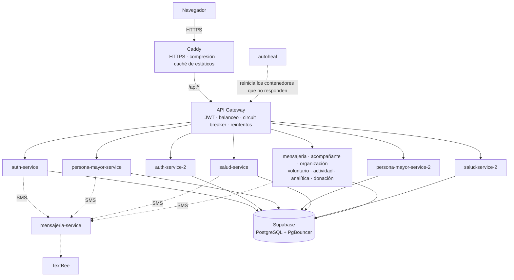

# Disponibilidad y tolerancia a fallos de Vita+

Este documento reúne las decisiones de arquitectura que evitan que la plataforma se caiga, o que, si una parte falla, el resto siga funcionando. Distingue lo que **ya existía** antes del 15 de octubre de 2026 de lo que se **implementó ese día**, e indica dónde está cada cosa en el código y cómo se comprobó.

## Contexto: cómo está desplegada la plataforma

Vita+ corre en **un solo servidor** (8 GB de RAM) con Docker Compose. La base de datos es PostgreSQL en **Supabase** (servicio administrado externo), y los SMS salen por **TextBee**.

## Resumen

| # | Mecanismo | Estado | Protege contra |
|---|---|---|---|
| 1 | Punto de entrada único (API Gateway) | Ya existía | Exponer servicios internos, lógica de seguridad repetida |
| 2 | Proxy inverso con HTTPS (Caddy) | Ya existía | Tráfico sin cifrar, puertos internos expuestos |
| 3 | Reinicio automático de contenedores (`restart: unless-stopped`) | Ya existía | Un servicio que se cae (el proceso termina) |
| 4 | Límites de memoria por contenedor y JVM acotada | Ya existía | Un servicio que consume toda la RAM y tumba a los demás |
| 5 | Pool de conexiones pequeño + pooler de Supabase | Ya existía | Agotar las conexiones de la base de datos |
| 6 | Autenticación sin estado (JWT) | Ya existía | Depender de una sesión guardada en un servidor (permite réplicas) |
| 7 | Degradación elegante en el envío de SMS | Ya existía | Que una falla de SMS rompa la operación principal |
| 8 | Avisos idempotentes en los recordatorios (medicamentos y citas) | Ya existía | SMS duplicados si el scheduler corre dos veces |
| 9 | Caché y tiempos máximos de espera para Google Places | Ya existía | Costos de API y un proveedor externo lento |
| 10 | Notificaciones en tiempo real (SSE) con reconexión | Ya existía | Pantallas desactualizadas |
| 11 | **Health checks** (Spring Boot Actuator + Docker) | **Nuevo** | No saber si un servicio está vivo |
| 12 | **Autoreparación** (autoheal) | **Nuevo** | Un servicio encendido pero colgado |
| 13 | **Balanceo de carga y réplicas** (Spring Cloud LoadBalancer) | **Nuevo** | La caída de un servicio crítico deja sin servicio a todos |
| 14 | **Circuit breaker por ruta** (Resilience4j) | **Nuevo** | Fallas en cascada y peticiones colgadas acumulándose |
| 15 | **Reintentos seguros en el gateway** | **Nuevo** | Fallas pasajeras y réplicas caídas |
| 16 | **Tiempos máximos de espera** (gateway y llamadas entre servicios) | **Nuevo** | Un servicio lento que bloquea a quien lo llama |
| 17 | **Bloqueo distribuido de tareas programadas** (ShedLock) | **Nuevo** | Tareas duplicadas al tener réplicas |
| 18 | **Caché de catálogos** (Caffeine) | **Nuevo** | Consultas repetidas a la base de datos |
| 19 | **Caché del navegador para el frontend** (Caddy) | **Nuevo** | Descargar la aplicación completa en cada visita |
| 20 | **Apagado ordenado** (graceful shutdown) | **Nuevo** | Cortar peticiones a medias al reiniciar o actualizar |
| 21 | **Reintentos en el frontend** | **Nuevo** | Mostrar errores por un corte de red de un segundo |

---

## Lo que ya existía

### 1. Punto de entrada único: API Gateway

Todo el tráfico del frontend entra por `api-gateway` (Spring Cloud Gateway, puerto 8080), que valida el JWT (`JwtAuthGatewayFilterFactory`) y enruta cada petición al servicio correspondiente. Los servicios no se exponen a internet.

- **Dónde:** `backend/api-gateway/src/main/resources/application.yml` (rutas), `backend/api-gateway/.../filter/JwtAuthGatewayFilterFactory.java`.
- **Por qué ayuda:** centraliza la seguridad y es el lugar natural para el balanceo, el circuit breaker y los reintentos (ver la sección de lo nuevo).

### 2. Proxy inverso con HTTPS: Caddy

El contenedor `web` sirve el frontend de Angular y reenvía `/api/*` al gateway. Obtiene y renueva solo el certificado HTTPS (Let's Encrypt) y comprime las respuestas (`encode zstd gzip`). Es el único contenedor con puertos abiertos (80 y 443).

- **Dónde:** `frontend/Caddyfile`, `frontend/Dockerfile`, servicio `web` en `docker-compose.yml`.

### 3. Reinicio automático de contenedores

Todos los contenedores tienen `restart: unless-stopped`: si el proceso de un servicio termina (por ejemplo, por un error de memoria), Docker lo vuelve a levantar.

- **Dónde:** `docker-compose.yml` (ancla `x-servicio`).
- **Límite:** no cubre un servicio que sigue encendido pero dejó de responder; eso lo resuelve ahora *autoheal* (punto 12).

### 4. Límites de memoria

Cada contenedor tiene `mem_limit: 600m`, y la JVM arranca con `-Xmx256m -XX:MaxMetaspaceSize=192m -XX:+UseSerialGC`. Así, un servicio con una fuga de memoria no puede consumir toda la RAM del servidor y tumbar a los demás.

- **Dónde:** `docker-compose.yml`, `backend/Dockerfile` (`JAVA_OPTS`).

### 5. Pool de conexiones acotado y pooler de Supabase

Todos los servicios comparten una sola base de datos. Cada uno abre como máximo 3 conexiones (`spring.datasource.hikari.maximum-pool-size=3`) y se conecta por el *pooler* de Supabase (PgBouncer, puerto 6543), que multiplexa las conexiones. Esto evita agotar el límite de conexiones de PostgreSQL, que con muchos servicios es una causa común de caídas.

- **Dónde:** `application.properties` de cada servicio.

### 6. Autenticación sin estado (JWT)

La sesión viaja en el token JWT; ningún servicio guarda sesiones en memoria. Gracias a esto, cualquier réplica puede atender cualquier petición, que es la condición para poder balancear la carga (punto 13).

### 7. Degradación elegante en los SMS

Los clientes de `mensajeria-service` (`MensajeriaClient` en salud, persona mayor, actividad y auth) capturan los errores: si un SMS no sale, la operación principal (registrar una cita, activar una emergencia) no falla.

### 8. Recordatorios idempotentes

Los recordatorios de medicamentos y de citas médicas **reservan cada aviso en la base de datos** antes de enviarlo (consultas `reservarAviso...` con `@Modifying`). Si el scheduler corre dos veces, o en dos instancias, solo una consigue la reserva y envía el SMS.

- **Dónde:** `salud-service/.../scheduler/MedicamentoRecordatorioScheduler.java`, `CitaMedicaRecordatorioScheduler.java`, `MedicamentoRepository`, `CitaMedicaRepository`.
- **Consecuencia:** `salud-service` se pudo replicar sin cambios en sus schedulers.

### 9. Google Places: caché y tiempos máximos de espera

La búsqueda de lugares guarda en memoria las últimas 500 búsquedas (LRU), para no pagar dos veces la misma consulta, y corta la llamada si Google no conecta en 5 s o no responde en 10 s.

- **Dónde:** `analitica-service/.../lugares/BuscadorLugares.java`.

### 10. Tiempo real con reconexión

El gateway publica avisos de cambio por SSE (`/api/eventos`) y el frontend vuelve a consultar los datos al recibirlos o al reconectarse. Caddy no guarda la respuesta en búfer (`flush_interval -1`).

- **Dónde:** `api-gateway/.../eventos/`, `frontend/src/app/core/tiempo-real/`.

---

## Lo que se implementó

### 11. Health checks

Los 11 servicios y el gateway incluyen **Spring Boot Actuator**, que expone `/actuator/health/liveness` (el proceso está vivo) y `/actuator/health/readiness` (está listo para recibir tráfico). Solo se expone `health`, ningún otro endpoint de Actuator.

En el servidor, el health check va en el **puerto 9000** (`MANAGEMENT_SERVER_PORT`), separado del de la API, y no se publica: el gateway solo enruta `/api/**`. En `auth-service`, que tiene Spring Security, se permitió el acceso a `/actuator/health/**`.

Docker revisa cada servicio cada 15 s con `curl` (que se agregó a la imagen). Después de 4 fallos seguidos, lo marca como `unhealthy`. El `start_period` de 120 s da tiempo a que arranque Spring.

> **Decisión:** se usa *liveness* y no el health completo, porque este último incluye la base de datos. Si Supabase falla, reiniciar los servicios no lo arregla y solo provocaría reinicios en cadena.

- **Dónde:** `pom.xml` y `application.properties` de cada servicio, `backend/Dockerfile`, `healthcheck` en `docker-compose.yml`, `auth-service/.../security/SecurityConfig.java`.

### 12. Autoreparación: autoheal

`restart: unless-stopped` solo actúa si el proceso termina. Un servicio colgado (sin memoria libre, bloqueado, sin responder) sigue "encendido" para Docker. El contenedor `autoheal` revisa cada 10 s y **reinicia los contenedores marcados como `unhealthy`**.

- **Dónde:** servicio `autoheal` en `docker-compose.yml`. Actúa sobre los contenedores con la etiqueta `autoheal=true`, que llevan todos los servicios.
- **Consideración de seguridad:** autoheal necesita el socket de Docker (`/var/run/docker.sock`). Es una imagen pública muy usada (`willfarrell/autoheal`), con la versión fijada en `1.2.0`.

### 13. Balanceo de carga y réplicas

Tres servicios corren en **dos réplicas** cada uno, elegidos por ser los más críticos para una persona mayor:

| Servicio | Por qué se replicó |
|---|---|
| `auth-service` | Sin él nadie puede iniciar sesión |
| `persona-mayor-service` | Tiene el **botón de emergencia** |
| `salud-service` | Medicamentos, citas médicas y sus recordatorios |

El gateway usa **Spring Cloud LoadBalancer**: las rutas apuntan a `lb://<servicio>` y el balanceador reparte las peticiones entre las instancias con *round robin*. En desarrollo, cada servicio tiene una sola instancia en `localhost`. En el servidor, el perfil `docker` (`application-docker.yml`) agrega la segunda réplica. Cada segunda réplica arranca cuando la primera ya está sana (`depends_on: condition: service_healthy`), para que no ejecuten al mismo tiempo las tareas de arranque (crear tablas, catálogos o el bucket de fotos).

**Servicios que no se replicaron y por qué:**

- **`mensajeria-service`**: guarda los códigos OTP en memoria (`TextBeeOtpService`). Con dos réplicas, el código se podría generar en una y verificar en la otra. Replicarlo requiere guardar los OTP en la base de datos o en Redis.
- **`api-gateway`**: los avisos en tiempo real (SSE) viven en memoria del gateway (`CambiosPublisher`). Con dos gateways, un cambio hecho a través de uno no avisaría a quienes están conectados al otro. Replicarlo requiere un canal compartido (Redis Pub/Sub).
- **Los demás**: por memoria. Cada réplica consume entre 300 y 450 MB. Con las tres réplicas hay 15 JVM, alrededor de 5,5 a 6 GB en uso real, dentro de los 8 GB del servidor.

- **Dónde:** `api-gateway/pom.xml` (`spring-cloud-starter-loadbalancer`), `application.yml` (`spring.cloud.discovery.client.simple.instances` y rutas `lb://`), `application-docker.yml`, servicios `*-2` en `docker-compose.yml`.

> **Decisión técnica:** se probó el *health check activo* del balanceador (`spring.cloud.loadbalancer.configurations: health-check`). Con la lista fija de instancias, en esta versión (Spring Cloud 2025.1.2, LoadBalancer 5.0.2), no recibe ninguna instancia y deja **todas** las rutas sin servicio. Lo detectó la prueba `ReplicaCaidaTest`. Por eso, a las réplicas caídas las saltan los reintentos (punto 15) y las reinicia autoheal (punto 12).

### 14. Circuit breaker por ruta

Cada ruta del gateway tiene su propio **circuit breaker** (Resilience4j, filtro `CircuitBreaker` en `default-filters`; el nombre se toma del id de la ruta). Si en las últimas 20 peticiones de una ruta (mínimo 10) falla la mitad o más, el circuito se **abre** durante 20 s. En ese tiempo, el gateway responde de inmediato con un **503 y un mensaje para la persona**, en vez de acumular peticiones a un servicio que no responde. Después deja pasar 3 peticiones de prueba y, si salen bien, lo cierra.

El mensaje es: *"Esta parte de Vita+ no está disponible en este momento. Intenta de nuevo en unos minutos."* El frontend ya muestra el texto de los errores tal cual (`mensajeDeError`).

Como cada ruta tiene su circuito, la caída de analítica no afecta el inicio de sesión, por ejemplo.

| Parámetro | Valor |
|---|---|
| Ventana | 20 peticiones (mínimo 10) |
| Umbral de fallas | 50 % |
| Tiempo abierto | 20 s |
| Peticiones de prueba | 3 |
| Tiempo máximo por petición | 20 s (60 s para analítica, por el PDF) |
| Estados que cuentan como falla | 502, 503, 504, errores de conexión y tiempo agotado |

- **Dónde:** `api-gateway/pom.xml` (`spring-cloud-starter-circuitbreaker-reactor-resilience4j`), `application.yml` (`default-filters` y `resilience4j`), `api-gateway/.../fallback/FallbackController.java`.

### 15. Reintentos seguros en el gateway

Hay dos filtros `Retry`, pensados para **nunca duplicar una operación**:

1. **GET**: se repiten hasta 2 veces, con espera de 200 ms y luego 400 ms, si no hubo respuesta a tiempo o si llegó 502, 503 o 504. Repetirlos es seguro porque un GET no cambia datos.
2. **Cualquier método** (POST, PUT, DELETE...): se repite **solo si no se pudo conectar** (conexión rechazada o host inexistente, por ejemplo una réplica apagada o reiniciándose). En ese caso la petición nunca llegó al servicio, así que repetir un POST no crea dos registros ni envía dos alertas.

Con `spring.cloud.loadbalancer.retry.enabled: true`, el reintento **va a una instancia distinta** de la que falló. Así, con una réplica caída, el login o el botón de emergencia llegan a la otra.

El circuit breaker envuelve a los reintentos, así que solo cuenta como falla lo que siguió fallando después de reintentar. Una réplica caída no abre el circuito mientras la otra responda.

- **Dónde:** `application.yml` del gateway (`default-filters`, `spring.cloud.loadbalancer.retry`).

### 16. Tiempos máximos de espera

Sin tiempos máximos, un servicio que se cuelga deja colgado a quien lo llama, y así sucesivamente.

| Llamada | Conexión | Respuesta |
|---|---|---|
| Gateway → servicios | 3 s | 60 s (más el límite del circuit breaker: 20 s, o 60 s para analítica) |
| Servicios → `mensajeria-service` (salud, persona mayor, actividad, auth) | 3 s | 15 s |
| `auth-service` → Supabase Storage (fotos de perfil) | 5 s | 30 s |
| `analitica-service` → Google Places | 5 s | 10 s (ya existía) |

- **Dónde:** `application.yml` del gateway (`httpclient`), `MensajeriaClientConfig.java` de cada servicio, `auth-service/.../service/FotoPerfilStorage.java`.

### 17. Bloqueo distribuido de tareas programadas: ShedLock

Con dos réplicas de `persona-mayor-service`, las dos correrían la tarea de cumpleaños de las 8 a. m. y cada persona recibiría **dos** felicitaciones. Con **ShedLock**, la réplica que empieza la tarea deja una marca en la tabla `shedlock` de la base de datos y la otra se salta esa ejecución. Se usa la hora de la base de datos, para que no importe si los relojes de las réplicas están desfasados. La marca dura al menos 5 minutos y como máximo 30.

`salud-service` no lo necesita: sus recordatorios ya eran idempotentes (punto 8).

- **Dónde:** `persona-mayor-service/pom.xml` (`shedlock-spring` y `shedlock-provider-jdbc-template` 7.10.1), `config/BloqueoTareasConfig.java` (crea la tabla si no existe), `@SchedulerLock` en `scheduler/CumpleanosScheduler.java`.
- **Si se replica otro servicio con tareas programadas** (actividad o analítica), hay que agregarle ShedLock de la misma forma.

### 18. Caché de catálogos: Caffeine

Los catálogos casi no cambian y los piden todos los formularios. Se guardan en memoria con **Caffeine**:

| Catálogo | Servicio | Duración | Se borra cuando |
|---|---|---|---|
| Gustos, talentos y pasatiempos (`GET /api/gustos`) | persona mayor | 10 min | Se crea, edita o borra un gusto (`@CacheEvict`) |
| Enfermedades, alergias y discapacidades (`GET .../condiciones-salud/catalogo`) | salud | 1 h | Solo cambia al arrancar el servicio |

> **Decisión:** caché local por instancia en vez de una caché distribuida (Redis). Para catálogos casi estáticos no compensa agregar y mantener otro servidor. La consecuencia es que, si se edita un gusto, la otra réplica lo muestra a más tardar en 10 minutos. No se cacheó información personal ni los reportes de analítica: deben verse al instante cuando cambian (el tiempo real avisa al frontend y este vuelve a consultar).

- **Dónde:** `pom.xml` (`spring-boot-starter-cache`, `caffeine`), `config/CacheConfig.java` y `application.properties` (`spring.cache.*`) de persona mayor y salud, `@Cacheable` en `GustoController` y `CondicionSaludController`.

### 19. Caché del navegador para el frontend

Los archivos `.js` y `.css` que genera Angular llevan un *hash* en el nombre (`main-ABC123.js`) que cambia en cada versión. Caddy los marca con `Cache-Control: public, max-age=31536000, immutable`, así que el navegador los guarda un año y no los vuelve a descargar. `index.html` va con `no-cache`, para que siempre apunte a los archivos de la versión vigente. Esto reduce la carga del servidor y acelera las visitas, que es importante con conexiones lentas.

- **Dónde:** `frontend/Caddyfile`.

### 20. Apagado ordenado

Con `server.shutdown=graceful`, al detener o actualizar un servicio, Spring deja de aceptar peticiones nuevas y **termina las que están en curso** (hasta 20 s) antes de cerrar. Con réplicas, se puede reiniciar una mientras la otra atiende.

- **Dónde:** `application.properties` de cada servicio y `application.yml` del gateway.

### 21. Reintentos en el frontend

Un interceptor HTTP de Angular repite **solo las consultas (GET)** que fallan por un error pasajero: sin conexión (0), 502, 503 o 504. Hace hasta 2 reintentos, después de 1 s y de 2 s. Si un GET falla por algo que no es pasajero (por ejemplo, un 404), el error se muestra de inmediato. Los POST, PUT y DELETE nunca se repiten desde el navegador.

- **Dónde:** `frontend/src/app/core/reintentos/reintentos.interceptor.ts`, registrado en `app.config.ts`.

---

## Cómo se comprobó

| Prueba | Qué demuestra |
|---|---|
| `api-gateway/.../fallback/ServicioCaidoTest` | Con un servicio caído, el gateway responde 503 con el mensaje amable, sin quedarse colgado |
| `api-gateway/.../fallback/ReplicaCaidaTest` | Con una de dos réplicas apagada, **todos** los GET y POST llegan a la réplica viva; un POST que el servicio sí recibió (respondió 500) **no se repite** |
| `api-gateway/.../RutasGatewayTest` | Cada ruta apunta al servicio correcto (`lb://<servicio>`) |
| `persona-mayor-service/.../config/BloqueoTareasConfigTest` | Si una réplica tomó la tarea de cumpleaños, la segunda no la puede tomar |
| `persona-mayor-service/.../controller/GustoCacheTest` | El catálogo se consulta una sola vez a la base y la caché se borra al agregar un gusto |
| `frontend/.../reintentos/reintentos.interceptor.spec.ts` | Los GET se reintentan ante errores pasajeros; los 404 y los POST nunca |

Las pruebas existentes de todos los servicios siguen pasando.

**Pendiente de verificar en el servidor:** levantar todo con `docker compose up -d --build` y comprobar con `docker compose ps` que todos los contenedores quedan `healthy`. Luego detener una réplica (`docker compose stop salud-service-2`) y confirmar que la plataforma sigue respondiendo. Estas pruebas no se hicieron todavía en un entorno real con Docker.

---

## Limitaciones conocidas y siguientes pasos

| Limitación | Impacto | Cómo resolverla |
|---|---|---|
| Un solo servidor | Si se cae la máquina, se cae todo | Segundo servidor con un balanceador delante (por ejemplo, el de AWS) |
| Una sola instancia del gateway | Si el gateway falla, la API no responde hasta que autoheal lo reinicia (alrededor de 1 minuto) | Avisos de tiempo real por Redis Pub/Sub y dos gateways detrás de Caddy |
| `mensajeria-service` sin réplica | Sin SMS ni códigos OTP mientras se reinicia | Guardar los OTP en la base de datos o en Redis y replicarlo |
| Base de datos única (Supabase) | Si Supabase falla, fallan todos los servicios | Depende del plan de Supabase (réplicas de lectura, *point-in-time recovery*) |
| Sin límite de peticiones (*rate limiting*) | Un abuso, como pedir muchos códigos OTP, podría saturar un servicio o gastar SMS | Filtro `RequestRateLimiter` del gateway (requiere Redis) o límite en Caddy |
| Sin monitoreo centralizado | Las caídas se ven en los logs, no en un tablero | Exponer `/actuator/prometheus` y usar Prometheus con Grafana |
| `ddl-auto=update` en producción | Un cambio de modelo podría alterar tablas al arrancar | Migraciones versionadas (Flyway) |
