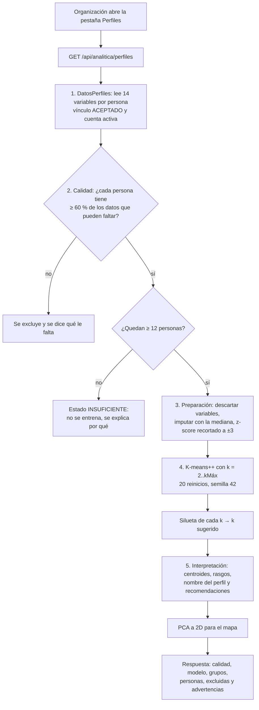

# Perfiles de las personas mayores con K-means

Este documento explica cómo VITA+ agrupa a las personas mayores de una organización en **perfiles** con características parecidas (condiciones de salud, signos vitales, edad y necesidades de acompañamiento) usando el algoritmo **K-means**, y cómo esos perfiles orientan las recomendaciones de atención y de actividades. También documenta cómo se evalúa si los datos alcanzan para entrenar el modelo y cuáles son las limitaciones de los resultados.

> Los perfiles **solo informan** (RNF-13): orientan a la organización para planear la atención y las actividades. No son un diagnóstico, no reemplazan el criterio de un profesional de salud y no cambian nada en la plataforma.

## Dónde está en la plataforma

| Parte | Archivo |
|---|---|
| Endpoint `GET /api/analitica/perfiles?k=` | [backend/analitica-service/.../controller/PerfilesController.java](backend/analitica-service/src/main/java/com/proyectogrado/analitica_service/controller/PerfilesController.java) |
| Lectura de los datos (SQL de solo lectura) | [perfiles/DatosPerfiles.java](backend/analitica-service/src/main/java/com/proyectogrado/analitica_service/perfiles/DatosPerfiles.java) |
| Variables del modelo | [perfiles/VariablePerfil.java](backend/analitica-service/src/main/java/com/proyectogrado/analitica_service/perfiles/VariablePerfil.java) |
| Calidad, preparación, entrenamiento e interpretación | [perfiles/SegmentacionPerfiles.java](backend/analitica-service/src/main/java/com/proyectogrado/analitica_service/perfiles/SegmentacionPerfiles.java) |
| Algoritmo K-means++, Lloyd y silueta | [perfiles/KMeans.java](backend/analitica-service/src/main/java/com/proyectogrado/analitica_service/perfiles/KMeans.java) |
| Proyección a 2D para el mapa (PCA) | [perfiles/Pca.java](backend/analitica-service/src/main/java/com/proyectogrado/analitica_service/perfiles/Pca.java) |
| Respuesta (DTO) | [perfiles/PerfilesDtos.java](backend/analitica-service/src/main/java/com/proyectogrado/analitica_service/perfiles/PerfilesDtos.java) |
| Pestaña «Perfiles» de la analítica de la organización | [frontend/.../analitica/reportes/reporte-perfiles.ts](frontend/src/app/pages/panel/organizacion/analitica/reportes/reporte-perfiles.ts) |
| Pruebas | [KMeansTest.java](backend/analitica-service/src/test/java/com/proyectogrado/analitica_service/perfiles/KMeansTest.java), [PerfilesControllerTest.java](backend/analitica-service/src/test/java/com/proyectogrado/analitica_service/controller/PerfilesControllerTest.java), [reporte-perfiles.spec.ts](frontend/src/app/pages/panel/organizacion/analitica/reportes/reporte-perfiles.spec.ts) |

### Por qué en analitica-service

- Ya lee con SQL las tablas de los demás servicios en la base compartida, **sin JPA y sin poder modificar el esquema**. No hizo falta crear tablas ni tocar otros servicios.
- Ya resuelve la organización del usuario (`OrganizacionActual`) y limita todo a las personas con vínculo **ACEPTADO**.
- La pestaña nueva reutiliza los componentes de la analítica: indicadores (`Kpi`), tarjetas de gráfica con vista de tabla (`TarjetaGrafica`), el tema de ECharts, la recarga en tiempo real y la **exportación a PDF**.

### Por qué K-means implementado en Java (sin librería)

- Son unas 200 líneas, fáciles de leer y de explicar en el documento de grado, sin cajas negras.
- No agrega dependencias ni un servicio aparte en Python (el servidor tiene 8 GB de RAM y ya corre 15 contenedores).
- El volumen es pequeño (decenas o cientos de personas por organización): el cálculo tarda milisegundos y se hace en cada petición, así que **nunca queda un modelo desactualizado**.

## Flujo completo



## 1. Variables (selección)

Se eligieron variables que **ya registra la plataforma** y que describen las cuatro dimensiones pedidas. Cada una tiene un *peso* para calcular el puntaje de necesidad de su dimensión: `+1` cuando más es más necesidad, `−1` cuando menos es más necesidad, y `0` cuando solo entra al modelo.

| Dimensión | Variable | De dónde sale | Peso | ¿Puede faltar? |
|---|---|---|---|---|
| Edad | Edad (años) | `usuario.fecha_nacimiento` | +1 | Sí |
| Condiciones de salud | Enfermedades crónicas | `persona_mayor_condicion_salud` + `condicion_salud` (tipo ENFERMEDAD) | +1 | No |
| | Discapacidades | ídem (tipo DISCAPACIDAD) | +1 | No |
| | Condiciones severas | ídem (severidad SEVERA) | +1 | No |
| | Medicamentos activos | `medicamento` (activo y sin fecha fin vencida) | +1 | No |
| Signos vitales (180 días) | Presión sistólica promedio | `signo_vital` | 0 | Sí |
| | Saturación de oxígeno promedio | `signo_vital` | −1 | Sí |
| | Pulso promedio | `signo_vital` | 0 | Sí |
| | Índice de masa corporal | última medición con peso y estatura | 0 | Sí |
| | % de mediciones fuera de rango | `signo_vital` contra los rangos de referencia | +1 | Sí |
| Necesidades de acompañamiento | Vive sola (0 o 100) | `persona_mayor.vive_solo` | +1 | Sí |
| | Acompañantes vinculados | `persona_mayor_acompanante` (ACEPTADA, cuenta activa) | −1 | No |
| | % de citas que piden acompañamiento | `cita_medica.acompanamiento` (REQUERIDO o PREFERIDO), último año y próximos 90 días | +1 | Sí |
| | Emergencias en 90 días | `emergencia` | +1 | No |

**Lo que no entra al modelo y por qué:**

- **Alergias:** no describen necesidad de cuidado ni de acompañamiento, y agregarían ruido.
- **Género, EPS y barrio:** son atributos demográficos o administrativos, no necesidades. Además, agrupar por ellos podría dar recomendaciones sesgadas.
- **Intereses y asistencia a actividades:** se muestran para cada grupo, porque sirven para elegir actividades, pero **no** se usan para formar los grupos. Así los perfiles responden solo a salud y acompañamiento.

**Reglas de limpieza al leer:**

- Los signos vitales fuera de lo físicamente posible (los mismos límites de `SignoVitalValidador` y del frontend, por ejemplo una presión sistólica fuera de 60–260) se toman como errores de digitación y se ignoran.
- Las edades por fuera de 40–120 años se toman como errores de registro.
- Una medición está *fuera de rango* si alguno de sus indicadores sale de los rangos de referencia para adultos: presión 90–139 / 60–89 mmHg, pulso 60–100 lpm, temperatura 36–37,5 °C o saturación menor que 95 %. Son los mismos rangos de `rangos.ts`.

## 2. Calidad y suficiencia de los datos (antes de entrenar)

Antes de entrenar se revisa si los datos alcanzan. Si no alcanzan, **no se entrena** y la pantalla explica por qué.

1. **Inclusión por persona.** De las 8 variables que pueden faltar, la persona debe tener al menos el 60 % (5 de 8). En la práctica, quien no tiene signos vitales en los últimos 180 días queda por fuera. Las personas excluidas aparecen en una tabla con lo que les falta registrar, por ejemplo «Signos vitales de los últimos 180 días» o «Fecha de nacimiento».
2. **Mínimo de personas.** Se necesitan al menos **12 personas** incluidas (`MIN_PERSONAS`). Con menos, el estado es `INSUFICIENTE`.
3. **Completitud por variable.** Es el porcentaje de las personas vinculadas que tiene cada dato y se ve en la gráfica «Calidad de los datos».
4. **Descarte de variables.** Una variable no entra al modelo si falta en más del 50 % de las personas incluidas, o si todas tienen el mismo valor (varianza cero; por ejemplo, si nadie registró discapacidades).
5. **Porcentaje imputado.** Es la proporción de valores del modelo que se completaron con la mediana.
6. **Datos de prueba.** Se cuentan las cuentas del script de datos ficticios (correo `@vitaplus.test` o celular `+570000…`) y se avisa cuando hay alguna.
7. **Nivel de calidad:**

| Nivel | Condición |
|---|---|
| BUENA | ≥ 50 personas, ≤ 10 % imputado y ningún dato de prueba |
| ACEPTABLE | ≥ 25 personas y ≤ 25 % imputado |
| LIMITADA | ≥ 12 personas, pero no cumple lo anterior |
| INSUFICIENTE | < 12 personas (o menos de 2 variables utilizables) |

Las **advertencias** se generan con los datos de cada organización. Avisan, por ejemplo, de que hay datos ficticios, de que con menos de 30 personas los grupos son poco estables, de que más del 15 % de los valores se imputó, de que la silueta es menor que 0,25, de grupos con menos de 3 personas y de las variables descartadas.

## 3. Preparación y normalización

1. **Imputación con la mediana** de las personas incluidas. Se usa la mediana y no la media porque es robusta a valores extremos.
2. **Estandarización z-score:** `z = (x − media) / desviación estándar`. K-means usa distancias euclidianas; sin estandarizar, la presión (≈ 120) pesaría mucho más que el número de enfermedades (≈ 2) solo por su escala.
3. **Recorte a ±3 desviaciones:** un valor extremo (por ejemplo, 10 emergencias) no arrastra él solo un centroide.

## 4. K-means

**Objetivo:** dividir las *n* personas en *k* grupos de modo que se minimice la **inercia**, es decir, la suma de las distancias al cuadrado de cada persona al centro (centroide) de su grupo:

```
inercia = Σ_i ‖ z_i − μ_{grupo(i)} ‖²
```

**Algoritmo de Lloyd** (`KMeans.lloyd`):

1. Asignar cada persona al centroide más cercano.
2. Mover cada centroide al promedio de sus personas.
3. Repetir hasta que los centroides casi no se muevan (tolerancia 10⁻⁶) o hasta 300 iteraciones. Si un grupo queda vacío, recibe al punto más lejano de su centroide.

**Inicialización K-means++** (`KMeans.iniciarKMeansMasMas`): el primer centroide es una persona al azar. Cada centroide siguiente se elige con probabilidad proporcional a la distancia al cuadrado al centroide más cercano. Así los centros iniciales quedan repartidos y se evitan malas soluciones.

**Reinicios y reproducibilidad:** se ejecuta 20 veces con distintos inicios y se queda con la de menor inercia. El generador aleatorio usa una **semilla fija (42)**: con los mismos datos, la organización ve siempre los mismos grupos.

### Elección del número de grupos (k)

- Se prueban los valores `k = 2 … kMáx`, con `kMáx = mín(6, n / 4)`, para que haya en promedio al menos 4 personas por grupo y no más de 6 perfiles, que es lo que una organización puede atender de forma diferenciada.
- Para cada *k* se calcula el **coeficiente de silueta** promedio. Para cada persona, *a* es su distancia media a los de su grupo y *b* su distancia media al grupo vecino más cercano:

```
s = (b − a) / máx(a, b)        (de −1 a 1)
```

- Se **sugiere el k con la silueta más alta**. La **inercia** también se muestra (método del codo), pero no sirve sola para elegir porque siempre baja al agregar grupos.
- La organización puede cambiar *k* con el selector «Grupos» (`?k=`); un valor fuera de `2..kMáx` se ignora.
- Lectura de la silueta (Kaufman y Rousseeuw): > 0,5 grupos bien separados; 0,25–0,5 separación razonable; 0,1–0,25 débil; < 0,1 sin grupos claros.

## 5. Interpretación de los grupos

1. **Centroide** de cada grupo: el promedio de sus personas en cada variable, en sus unidades (por ejemplo, «84 años») y en desviaciones (z) respecto al promedio de la organización.
2. **Puntaje por dimensión:** el promedio de `peso × z` de las variables de esa dimensión. Si es positivo, el grupo tiene más necesidad que el promedio.
3. **Orden:** el Grupo 1 es el de **mayor necesidad**, medida como la suma de los puntajes positivos.
4. **Nombre del perfil:** se forma con las 1 o 2 dimensiones con puntaje ≥ 0,4:

   | Dimensión | Nombre |
   |---|---|
   | Condiciones de salud | Salud compleja |
   | Signos vitales | Signos vitales por vigilar |
   | Edad | Edad avanzada |
   | Acompañamiento | Necesita acompañamiento |

   Por ejemplo, «Salud compleja y necesita acompañamiento». Si ninguna dimensión llega a 0,4 y todas están en 0,1 o menos, el perfil es «Autónomos y estables»; en otro caso, «Perfil intermedio».
5. **Rasgos:** son las variables en que el grupo se aleja al menos 0,5 desviaciones del promedio, con el valor real; por ejemplo, «Medicamentos activos más alto que el promedio: 5 frente a 2,1».
6. **Recomendaciones de atención y de actividades:** son textos fijos por dimensión (ver `ATENCION` y `ACTIVIDADES` en `SegmentacionPerfiles`). Se suman los **intereses más comunes del grupo** para elegir actividades, y se muestra el **% de asistencia** a actividades como contexto.

### Visualización (pestaña «Perfiles» de la Analítica)

| Elemento | Qué muestra |
|---|---|
| Indicadores | Personas analizadas, perfiles encontrados, separación de los grupos (silueta) y calidad de los datos |
| «Ten en cuenta antes de usar estos perfiles» | Las advertencias de calidad y suficiencia |
| Mapa de los perfiles | Dispersión en 2D (PCA de las variables estandarizadas), un color por grupo |
| Tarjetas de perfil | Nombre, tamaño, rasgos, atención y actividades sugeridas, asistencia |
| Qué distingue a cada grupo | Barras con el z del centroide por variable; la tabla da los valores en unidades |
| Número de grupos | Silueta según k, con el sugerido marcado; la tabla incluye la inercia |
| Calidad de los datos | Completitud por variable; en gris, las que no entraron al modelo |
| Personas de cada grupo / sin datos suficientes | Para planear y para completar registros |

Todas las gráficas tienen vista de tabla (accesibilidad) y el reporte se puede **descargar en PDF** con las explicaciones y las limitaciones.

**Sobre el mapa:** el PCA solo sirve para dibujar. K-means agrupa con **todas** las variables, así que dos grupos pueden verse superpuestos en el plano y estar bien separados en el espacio completo. La etiqueta de cada eje indica qué porcentaje de la variación conserva.

## Limitaciones de los resultados

1. **Datos reales escasos.** Hoy la mayoría de los registros provienen de `backend/scripts/seed_datos_fictisios.sql`, que genera perfiles de salud sintéticos (hipertensión, diabetes, EPOC). Con esos datos, K-means **recupera la estructura con que se generaron**, no la de una población real. Por eso el reporte avisa cuántos registros son de prueba. Las conclusiones solo serán válidas con datos reales.
2. **Muestras pequeñas.** Cada organización se analiza por separado; con pocas decenas de personas, agregar o corregir unos registros puede cambiar los grupos. Se recomiendan al menos 30 personas con datos completos.
3. **Un 0 no siempre es un 0.** Los conteos (enfermedades, medicamentos, acompañantes, emergencias) dependen de lo que cada persona registró: «0 enfermedades» puede ser «no las ha registrado».
4. **La imputación acerca al promedio.** Completar con la mediana evita perder personas, pero las hace parecer más «promedio» de lo que son.
5. **Supuestos de K-means.** Supone grupos más o menos esféricos y de tamaño parecido, es sensible a los valores extremos (se mitiga con el recorte a ±3) y siempre devuelve *k* grupos aunque los datos no tengan grupos reales. Por eso se reporta la silueta.
6. **Signos vitales autorreportados.** Muchas mediciones las registra la propia persona o su acompañante, con equipos domésticos y frecuencias distintas.
7. **Recomendaciones genéricas.** Son reglas por dimensión, no planes de cuidado individuales. La organización decide qué hacer (RNF-13).
8. **Pesos iguales.** Todas las variables pesan igual en la distancia; las dimensiones con más variables (salud y signos) influyen más en la agrupación.

## Cómo probarlo

**Pruebas automáticas:**

```bash
# Backend: K-means, silueta, PCA y el endpoint con las consultas reales sobre H2
cd backend/analitica-service
./mvnw test -Dtest="KMeansTest,PerfilesControllerTest"

# Frontend: indicadores, tablas y PDF del reporte
cd frontend
npx ng test --watch=false
```

`PerfilesControllerTest` arma dos poblaciones bien distintas (8 «autónomas» y 8 «frágiles»), una persona sin datos, una de otra organización y una con vínculo pendiente. Comprueba lo siguiente:

- la calidad de los datos, las excluidas y las advertencias;
- que se descarten las variables sin datos o sin variación;
- que se encuentren los 2 grupos con silueta > 0,5 y que el de más necesidad salga primero;
- que la organización pueda elegir *k*;
- que con menos de 12 personas no se entrene.

**En la aplicación:**

1. Si quieres datos de prueba, corre `backend/scripts/seed_datos_fictisios.sql` (ver sus instrucciones).
2. Levanta el backend (`backend/start-backend.bat` o Docker Compose) y el frontend (`npm start` en `frontend`).
3. Inicia sesión con una cuenta de organización (por ejemplo, una `org…@vitaplus.test`, contraseña `Vita2025*`).
4. Ve a **Analítica → Perfiles**. Revisa los avisos, el mapa, las tarjetas de cada perfil y la calidad de los datos. Cambia el número de grupos con el selector y descarga el PDF.
5. Si quieres ver el caso de datos insuficientes, usa una organización con menos de 12 personas con signos vitales recientes.

También se puede llamar al endpoint a través del gateway:

```bash
curl -H "Authorization: Bearer <token de organización>" "http://localhost:8080/api/analitica/perfiles?k=3"
```

## Trabajo futuro

- Validar los perfiles con el equipo de las organizaciones cuando haya datos reales, y ajustar los umbrales (0,4 y 0,5) y las recomendaciones.
- Medir la estabilidad de los grupos (por ejemplo, con *bootstrap*) y mostrarla junto a la silueta.
- Probar algoritmos que admiten variables mixtas o grupos no esféricos (K-prototypes, clustering jerárquico, DBSCAN) y comparar sus resultados con los de K-means.
- Guardar un histórico de perfiles para ver cómo cambia cada persona en el tiempo.
