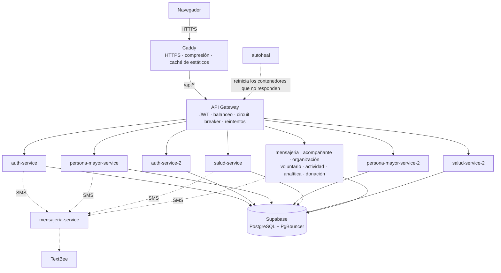

# Arquitectura de Vita+ y requisitos no funcionales

Este documento reúne las decisiones de arquitectura con las que Vita+ cumple sus requisitos no funcionales (RNF): disponibilidad, seguridad y privacidad, rendimiento, escalabilidad, mantenibilidad y portabilidad. Para cada decisión explica qué problema resuelve, dónde está en el código y cómo se comprobó. Los RNF están en `REQUERIMIENTOS.md`.

## Contexto: cómo está desplegada la plataforma

Vita+ corre en **un solo servidor** (8 GB de RAM) con Docker Compose. La base de datos es PostgreSQL en **Supabase** (servicio administrado externo), y los SMS salen por **TextBee**.

## Requisitos no funcionales y dónde se cumplen

| RNF | Qué pide | Dónde se explica |
|---|---|---|
| RNF-01 | Servicios independientes detrás de un único gateway | Puntos 1 y 38 |
| RNF-02 | Acceso protegido con JWT validado en el gateway | Puntos 23, 24 y 25 |
| RNF-03 | OTP como HMAC, con vencimiento a los 10 min y anulación tras 5 intentos | Punto 27 |
| RNF-04 | Actualización en tiempo real | Puntos 10 y 36 |
| RNF-05 | Recordatorios por SMS sin duplicados | Puntos 8 y 17 |
| RNF-06 | Hora de Colombia | Punto 43 |
| RNF-08 | PostgreSQL en Supabase | Contexto y punto 5 |
| RNF-09 | SMS con TextBee y validación de correos con Hunter | Puntos 7 y 27 |
| RNF-10 | Pruebas automatizadas sin base de datos real ni SMS | Punto 41 |
| RNF-11 | Java 17 con Spring Boot y Angular 17 o superior | Punto 42 |
| RNF-14 | Contenedores Docker con Docker Compose | Punto 42 |
| RNF-15 | Desplegada en un hosting accesible por internet | Pendiente (ver *Cómo se comprobó*) |
| RNF-16 | Tolerancia a fallos | Parte 1, puntos 11 a 21 |
| RNF-17 | Mapas de la organización sin la dirección exacta | Punto 30 |
| RNF-18 | Bloqueo tras 5 contraseñas incorrectas y límite de peticiones por IP | Puntos 22 y 26 |
| RNF-19 | Códigos por SMS solo a celulares con cuenta, con tope diario | Punto 27 |
| RNF-20 | Tokens de acceso de 15 minutos y sesiones revocables | Punto 23 |
| RNF-21 | Cabeceras de seguridad (CSP, HSTS y otras) | Punto 32 |
| RNF-22 | Registros sin datos personales | Punto 30 |
| RNF-23 | Contenedores sin root y con solo sus claves | Puntos 26 y 29 |
| RNF-24 | Fotos de perfil privadas | Punto 31 |
| RNF-25 | Registro de auditoría de los datos de salud | Punto 44 |
| RNF-26 | Revisión de dependencias y versiones exactas de las imágenes | Punto 45 |
| RNF-27 | Copias de seguridad propias y prueba de restauración | Punto 46 |
| RNF-28 | RLS en todas las tablas de Supabase | Punto 47 |
| Seguridad y privacidad en general | Datos protegidos, acceso solo con vínculo, cifrado | Parte 2, puntos 22 a 32 |
| Rendimiento | Páginas que cargan rápido con mala señal | Parte 3, puntos 33 a 37 |
| Escalabilidad | Crecer agregando instancias | Parte 4, punto 38 |

RNF-07 (usabilidad), RNF-12 (compatibilidad) y RNF-13 (apoyo a la decisión) se cumplen en el diseño de la interfaz y de las funcionalidades, no con decisiones de arquitectura, así que no se detallan aquí.

---

## 1. Disponibilidad y tolerancia a fallos

Estas decisiones evitan que la plataforma se caiga o, si una parte falla, permiten que el resto siga funcionando. Se distingue lo que **ya existía** antes del 15 de octubre de 2026 de lo que se **implementó ese día**.

### Resumen

| # | Mecanismo | Estado | Protege contra |
|---|---|---|---|
| 1 | Punto de entrada único (API Gateway) | Ya existía | Exponer servicios internos, lógica de seguridad repetida |
| 2 | Proxy inverso con HTTPS (Caddy) | Ya existía | Tráfico sin cifrar, puertos internos expuestos |
| 3 | Reinicio automático de contenedores (`restart: unless-stopped`) | Ya existía | Un servicio que se cae (el proceso termina) |
| 4 | Límites de memoria por contenedor y JVM acotada | Ya existía | Un servicio que consume toda la RAM y tumba a los demás |
| 5 | Pool de conexiones pequeño + pooler de Supabase | Ya existía | Agotar las conexiones de la base de datos |
| 6 | Autenticación sin estado (JWT) | Ya existía | Depender de una sesión guardada en un servidor (permite réplicas) |
| 7 | Degradación elegante en el envío de SMS | Ya existía | Que una falla de SMS rompa la operación principal |
| 8 | Avisos idempotentes en los recordatorios (medicamentos y citas) | Ya existía | SMS duplicados si el scheduler corre dos veces |
| 9 | Caché y tiempos máximos de espera para Google Places | Ya existía | Costos de API y un proveedor externo lento |
| 10 | Notificaciones en tiempo real (SSE) con reconexión | Ya existía | Pantallas desactualizadas |
| 11 | **Health checks** (Spring Boot Actuator + Docker) | **Nuevo** | No saber si un servicio está vivo |
| 12 | **Autoreparación** (autoheal) | **Nuevo** | Un servicio encendido pero colgado |
| 13 | **Balanceo de carga y réplicas** (Spring Cloud LoadBalancer) | **Nuevo** | La caída de un servicio crítico deja sin servicio a todos |
| 14 | **Circuit breaker por ruta** (Resilience4j) | **Nuevo** | Fallas en cascada y peticiones colgadas acumulándose |
| 15 | **Reintentos seguros en el gateway** | **Nuevo** | Fallas pasajeras y réplicas caídas |
| 16 | **Tiempos máximos de espera** (gateway y llamadas entre servicios) | **Nuevo** | Un servicio lento que bloquea a quien lo llama |
| 17 | **Tareas programadas en una sola réplica** | **Nuevo** | Tareas duplicadas al tener réplicas |
| 18 | **Caché de catálogos** (Caffeine) | **Nuevo** | Consultas repetidas a la base de datos |
| 19 | **Caché del navegador para el frontend** (Caddy) | **Nuevo** | Descargar la aplicación completa en cada visita |
| 20 | **Apagado ordenado** (graceful shutdown) | **Nuevo** | Cortar peticiones a medias al reiniciar o actualizar |
| 21 | **Reintentos en el frontend** | **Nuevo** | Mostrar errores por un corte de red de un segundo |

---

### Lo que ya existía

#### 1. Punto de entrada único: API Gateway

Todo el tráfico del frontend entra por `api-gateway` (Spring Cloud Gateway, puerto 8080), que valida el JWT (`JwtAuthGatewayFilterFactory`) y enruta cada petición al servicio correspondiente. Los servicios no se exponen a internet.

- **Dónde:** `backend/api-gateway/src/main/resources/application.yml` (rutas), `backend/api-gateway/.../filter/JwtAuthGatewayFilterFactory.java`.
- **Por qué ayuda:** centraliza la seguridad y es el lugar natural para el balanceo, el circuit breaker y los reintentos (ver la sección de lo nuevo).

#### 2. Proxy inverso con HTTPS: Caddy

El contenedor `web` sirve el frontend de Angular y reenvía `/api/*` al gateway. Obtiene y renueva solo el certificado HTTPS (Let's Encrypt) y comprime las respuestas (`encode zstd gzip`). Es el único contenedor con puertos abiertos (80 y 443).

- **Dónde:** `frontend/Caddyfile`, `frontend/Dockerfile`, servicio `web` en `docker-compose.yml`.

#### 3. Reinicio automático de contenedores

Todos los contenedores tienen `restart: unless-stopped`: si el proceso de un servicio termina (por ejemplo, por un error de memoria), Docker lo vuelve a levantar.

- **Dónde:** `docker-compose.yml` (ancla `x-servicio`).
- **Límite:** no cubre un servicio que sigue encendido pero dejó de responder; eso lo resuelve ahora *autoheal* (punto 12).

#### 4. Límites de memoria

Cada contenedor tiene `mem_limit: 600m`, y la JVM arranca con `-Xmx256m -XX:MaxMetaspaceSize=192m -XX:+UseSerialGC`. Así, un servicio con una fuga de memoria no puede consumir toda la RAM del servidor y tumbar a los demás.

- **Dónde:** `docker-compose.yml`, `backend/Dockerfile` (`JAVA_OPTS`).

#### 5. Pool de conexiones acotado y pooler de Supabase

Todos los servicios comparten una sola base de datos. Cada uno abre como máximo 3 conexiones (`spring.datasource.hikari.maximum-pool-size=3`) y se conecta por el *pooler* de Supabase (PgBouncer, puerto 6543), que multiplexa las conexiones. Esto evita agotar el límite de conexiones de PostgreSQL, que con muchos servicios es una causa común de caídas.

- **Dónde:** `application.properties` de cada servicio.

#### 6. Autenticación sin estado (JWT)

El token de acceso (JWT) lleva quién es el usuario; ningún servicio guarda sesiones en memoria. Gracias a esto, cualquier réplica puede atender cualquier petición, que es la condición para poder balancear la carga (punto 13). Las sesiones revocables (punto 23) se guardan en la base de datos, no en una réplica, así que tampoco lo impiden.

#### 7. Degradación elegante en los SMS

Los clientes de `mensajeria-service` (`MensajeriaClient` en salud, persona mayor, actividad y auth) capturan los errores: si un SMS no sale, la operación principal (registrar una cita, activar una emergencia) no falla.

#### 8. Recordatorios idempotentes

Los recordatorios de medicamentos y de citas médicas **reservan cada aviso en la base de datos** antes de enviarlo (consultas `reservarAviso...` con `@Modifying`). Si el scheduler corre dos veces, o en dos instancias, solo una consigue la reserva y envía el SMS.

- **Dónde:** `salud-service/.../scheduler/MedicamentoRecordatorioScheduler.java`, `CitaMedicaRecordatorioScheduler.java`, `MedicamentoRepository`, `CitaMedicaRepository`.
- **Consecuencia:** `salud-service` se pudo replicar sin cambios en sus schedulers.

#### 9. Google Places: caché y tiempos máximos de espera

La búsqueda de lugares guarda en memoria las últimas 500 búsquedas (LRU), para no pagar dos veces la misma consulta, y corta la llamada si Google no conecta en 5 s o no responde en 10 s.

- **Dónde:** `analitica-service/.../lugares/BuscadorLugares.java`.

#### 10. Tiempo real con reconexión

El gateway publica avisos de cambio por SSE (`/api/eventos`) y el frontend vuelve a consultar los datos al recibirlos o al reconectarse. Caddy no guarda la respuesta en búfer (`flush_interval -1`).

- **Dónde:** `api-gateway/.../eventos/`, `frontend/src/app/core/tiempo-real/`.

---

### Lo que se implementó

#### 11. Health checks

Los 11 servicios y el gateway incluyen **Spring Boot Actuator**, que expone `/actuator/health/liveness` (el proceso está vivo) y `/actuator/health/readiness` (está listo para recibir tráfico). Solo se expone `health`, ningún otro endpoint de Actuator.

En el servidor, el health check va en el **puerto 9000** (`MANAGEMENT_SERVER_PORT`), separado del de la API, y no se publica: el gateway solo enruta `/api/**`. En `auth-service`, que tiene Spring Security, se permitió el acceso a `/actuator/health/**`.

Docker revisa cada servicio cada 15 s con `curl` (que se agregó a la imagen). Después de 4 fallos seguidos, lo marca como `unhealthy`. El `start_period` de 120 s da tiempo a que arranque Spring.

> **Decisión:** se usa *liveness* y no el health completo, porque este último incluye la base de datos. Si Supabase falla, reiniciar los servicios no lo arregla y solo provocaría reinicios en cadena.

- **Dónde:** `pom.xml` y `application.properties` de cada servicio, `backend/Dockerfile`, `healthcheck` en `docker-compose.yml`, `auth-service/.../security/SecurityConfig.java`.

#### 12. Autoreparación: autoheal

`restart: unless-stopped` solo actúa si el proceso termina. Un servicio colgado (sin memoria libre, bloqueado, sin responder) sigue "encendido" para Docker. El contenedor `autoheal` revisa cada 10 s y **reinicia los contenedores marcados como `unhealthy`**.

- **Dónde:** servicio `autoheal` en `docker-compose.yml`. Actúa sobre los contenedores con la etiqueta `autoheal=true`, que llevan todos los servicios.
- **Consideración de seguridad:** autoheal necesita el socket de Docker (`/var/run/docker.sock`). Es una imagen pública muy usada (`willfarrell/autoheal`), con la versión fijada en `1.2.0`.

#### 13. Balanceo de carga y réplicas

Tres servicios corren en **dos réplicas** cada uno, elegidos por ser los más críticos para una persona mayor:

| Servicio | Por qué se replicó |
|---|---|
| `auth-service` | Sin él nadie puede iniciar sesión |
| `persona-mayor-service` | Tiene el **botón de emergencia** |
| `salud-service` | Medicamentos, citas médicas y sus recordatorios |

El gateway usa **Spring Cloud LoadBalancer**: las rutas apuntan a `lb://<servicio>` y el balanceador reparte las peticiones entre las instancias con *round robin*. En desarrollo, cada servicio tiene una sola instancia en `localhost`. En el servidor, el perfil `docker` (`application-docker.yml`) agrega la segunda réplica. Cada segunda réplica arranca cuando la primera ya está sana (`depends_on: condition: service_healthy`), para que no ejecuten al mismo tiempo las tareas de arranque (crear tablas, catálogos o el bucket de fotos).

**Servicios que no se replicaron y por qué:**

- **`mensajeria-service`**: guarda los códigos OTP en memoria (`TextBeeOtpService`). Con dos réplicas, el código se podría generar en una y verificar en la otra. Replicarlo requiere guardar los OTP en la base de datos o en Redis.
- **`api-gateway`**: los avisos en tiempo real (SSE) viven en memoria del gateway (`CambiosPublisher`). Con dos gateways, un cambio hecho a través de uno no avisaría a quienes están conectados al otro. Replicarlo requiere un canal compartido (Redis Pub/Sub).
- **Los demás**: por memoria. Cada réplica consume entre 300 y 450 MB. Con las tres réplicas hay 15 JVM, alrededor de 5,5 a 6 GB en uso real, dentro de los 8 GB del servidor.

- **Dónde:** `api-gateway/pom.xml` (`spring-cloud-starter-loadbalancer`), `application.yml` (`spring.cloud.discovery.client.simple.instances` y rutas `lb://`), `application-docker.yml`, servicios `*-2` en `docker-compose.yml`.

> **Decisión técnica:** se probó el *health check activo* del balanceador (`spring.cloud.loadbalancer.configurations: health-check`). Con la lista fija de instancias, en esta versión (Spring Cloud 2025.1.2, LoadBalancer 5.0.2), no recibe ninguna instancia y deja **todas** las rutas sin servicio. Lo detectó la prueba `ReplicaCaidaTest`. Por eso, a las réplicas caídas las saltan los reintentos (punto 15) y las reinicia autoheal (punto 12).

#### 14. Circuit breaker por ruta

Cada ruta del gateway tiene su propio **circuit breaker** (Resilience4j, filtro `CircuitBreaker` en `default-filters`; el nombre se toma del id de la ruta). Si en las últimas 20 peticiones de una ruta (mínimo 10) falla la mitad o más, el circuito se **abre** durante 20 s. En ese tiempo, el gateway responde de inmediato con un **503 y un mensaje para la persona**, en vez de acumular peticiones a un servicio que no responde. Después deja pasar 3 peticiones de prueba y, si salen bien, lo cierra.

El mensaje es: *"Esta parte de Vita+ no está disponible en este momento. Intenta de nuevo en unos minutos."* El frontend ya muestra el texto de los errores tal cual (`mensajeDeError`).

Como cada ruta tiene su circuito, la caída de analítica no afecta el inicio de sesión, por ejemplo.

| Parámetro | Valor |
|---|---|
| Ventana | 20 peticiones (mínimo 10) |
| Umbral de fallas | 50 % |
| Tiempo abierto | 20 s |
| Peticiones de prueba | 3 |
| Tiempo máximo por petición | 20 s (60 s para analítica, por el PDF) |
| Estados que cuentan como falla | 502, 503, 504, errores de conexión y tiempo agotado |

- **Dónde:** `api-gateway/pom.xml` (`spring-cloud-starter-circuitbreaker-reactor-resilience4j`), `application.yml` (`default-filters` y `resilience4j`), `api-gateway/.../fallback/FallbackController.java`.

#### 15. Reintentos seguros en el gateway

Hay dos filtros `Retry`, pensados para **nunca duplicar una operación**:

1. **GET**: se repiten hasta 2 veces, con espera de 200 ms y luego 400 ms, si no hubo respuesta a tiempo o si llegó 502, 503 o 504. Repetirlos es seguro porque un GET no cambia datos.
2. **Cualquier método** (POST, PUT, DELETE...): se repite **solo si no se pudo conectar** (conexión rechazada o host inexistente, por ejemplo una réplica apagada o reiniciándose). En ese caso la petición nunca llegó al servicio, así que repetir un POST no crea dos registros ni envía dos alertas.

Con `spring.cloud.loadbalancer.retry.enabled: true`, el reintento **va a una instancia distinta** de la que falló. Así, con una réplica caída, el login o el botón de emergencia llegan a la otra.

El circuit breaker envuelve a los reintentos, así que solo cuenta como falla lo que siguió fallando después de reintentar. Una réplica caída no abre el circuito mientras la otra responda.

- **Dónde:** `application.yml` del gateway (`default-filters`, `spring.cloud.loadbalancer.retry`).

#### 16. Tiempos máximos de espera

Sin tiempos máximos, un servicio que se cuelga deja colgado a quien lo llama, y así sucesivamente.

| Llamada | Conexión | Respuesta |
|---|---|---|
| Gateway → servicios | 3 s | 60 s (más el límite del circuit breaker: 20 s, o 60 s para analítica) |
| Servicios → `mensajeria-service` (salud, persona mayor, actividad, auth) | 3 s | 15 s |
| `auth-service` → Supabase Storage (fotos de perfil) | 5 s | 30 s |
| `analitica-service` → Google Places | 5 s | 10 s (ya existía) |

- **Dónde:** `application.yml` del gateway (`httpclient`), `MensajeriaClientConfig.java` de cada servicio, `auth-service/.../service/FotoPerfilStorage.java`.

#### 17. Tareas programadas en una sola réplica

Con dos réplicas de `persona-mayor-service`, las dos correrían la tarea de cumpleaños de las 8 a. m. y cada persona recibiría **dos** felicitaciones. Por eso solo la primera réplica corre las tareas programadas: `persona-mayor-service-2` arranca con `TAREAS_PROGRAMADAS_ACTIVAS=false` y no las agenda. No hace falta ninguna tabla de bloqueo en la base de datos.

Si la primera réplica está caída justo a las 8 a. m., ese día no salen las felicitaciones. Se acepta porque se reinicia sola (`restart` y autoheal) y es una sola tarea no crítica. Si algún día hay tareas más importantes, la alternativa es un bloqueo distribuido como ShedLock, que sí sigue funcionando con una réplica caída pero necesita una tabla en la base.

`salud-service` no lo necesita: sus recordatorios ya eran idempotentes (punto 8).

- **Dónde:** `persona-mayor-service/.../config/TareasProgramadasConfig.java` (`@EnableScheduling` solo si `tareas.programadas.activas` es `true`, el valor por defecto) y el `environment` de `persona-mayor-service-2` en `docker-compose.yml`.
- **Si se replica otro servicio con tareas programadas** (actividad o analítica), hay que apagarlas de la misma forma en la segunda réplica.

#### 18. Caché de catálogos: Caffeine

Los catálogos casi no cambian y los piden todos los formularios. Se guardan en memoria con **Caffeine**:

| Catálogo | Servicio | Duración | Se borra cuando |
|---|---|---|---|
| Gustos, talentos y pasatiempos (`GET /api/gustos`) | persona mayor | 10 min | Se agrega un gusto (`@CacheEvict`) |
| Enfermedades, alergias y discapacidades (`GET .../condiciones-salud/catalogo`) | salud | 1 h | Solo cambia al arrancar el servicio |

> **Decisión:** caché local por instancia en vez de una caché distribuida (Redis). Para catálogos casi estáticos no compensa agregar y mantener otro servidor. La consecuencia es que, si se agrega un gusto, la otra réplica lo muestra a más tardar en 10 minutos. No se cacheó información personal ni los reportes de analítica: deben verse al instante cuando cambian (el tiempo real avisa al frontend y este vuelve a consultar).

- **Dónde:** `pom.xml` (`spring-boot-starter-cache`, `caffeine`), `config/CacheConfig.java` y `application.properties` (`spring.cache.*`) de persona mayor y salud, `@Cacheable` en `GustoController` y `CondicionSaludController`.

#### 19. Caché del navegador para el frontend

Los archivos `.js` y `.css` que genera Angular llevan un *hash* en el nombre (`main-ABC123.js`) que cambia en cada versión. Caddy los marca con `Cache-Control: public, max-age=31536000, immutable`, así que el navegador los guarda un año y no los vuelve a descargar. `index.html` va con `no-cache`, para que siempre apunte a los archivos de la versión vigente. Esto reduce la carga del servidor y acelera las visitas, que es importante con conexiones lentas.

- **Dónde:** `frontend/Caddyfile`.

#### 20. Apagado ordenado

Con `server.shutdown=graceful`, al detener o actualizar un servicio, Spring deja de aceptar peticiones nuevas y **termina las que están en curso** (hasta 20 s) antes de cerrar. Con réplicas, se puede reiniciar una mientras la otra atiende.

- **Dónde:** `application.properties` de cada servicio y `application.yml` del gateway.

#### 21. Reintentos en el frontend

Un interceptor HTTP de Angular repite **solo las consultas (GET)** que fallan por un error pasajero: sin conexión (0), 502, 503 o 504. Hace hasta 2 reintentos, después de 1 s y de 2 s. Si un GET falla por algo que no es pasajero (por ejemplo, un 404), el error se muestra de inmediato. Los POST, PUT y DELETE nunca se repiten desde el navegador.

- **Dónde:** `frontend/src/app/core/reintentos/reintentos.interceptor.ts`, registrado en `app.config.ts`.

#### 46. Copias de seguridad propias (RNF-27)

Además de las copias que dé el plan de Supabase, hay dos scripts para tener una copia propia, que no dependa del proveedor:

| Script | Qué hace |
|---|---|
| `backend/scripts/respaldo.sh` | Saca una copia del esquema `public` con `pg_dump` y la guarda en `respaldos/`, solo con permisos para el dueño. Borra las de más de 30 días. Pensado para correr cada día con `cron` en el servidor |
| `backend/scripts/probar-restauracion.sh` | Restaura una copia en una base PostgreSQL desechable, en un contenedor, y compara cuántas filas tiene cada tabla con la base real. Al terminar, borra el contenedor |

Una copia que nunca se ha restaurado no está comprobada. Por eso el segundo script: conviene correrlo al menos una vez al mes y cada vez que cambie el modelo de datos.

> **Decisiones:**
> - Los dos usan la imagen oficial de PostgreSQL (`postgres:17.11-alpine`), así que en el servidor solo hace falta Docker.
> - Se conectan por el pooler de Supabase en **modo sesión** (puerto 5432), porque `pg_dump` no funciona en el modo transacción (6543) que usan los servicios.
> - La contraseña va por variable de entorno, no en la línea de comandos, donde la vería cualquiera que liste los procesos.
> - Las copias tienen datos personales y de salud: `respaldos/` y los `.dump` están en `.gitignore`. Conviene copiarlas también fuera del servidor, a un lugar cifrado.

- **Dónde:** `backend/scripts/respaldo.sh`, `backend/scripts/probar-restauracion.sh`, `.gitignore`.

---

## 2. Seguridad y privacidad

Vita+ guarda datos sensibles de personas mayores: salud, medicamentos, citas médicas, signos vitales, dirección y contactos. Las decisiones de esta parte buscan que **solo quien tiene un vínculo aceptado con una persona vea sus datos**, que esos datos viajen cifrados y que la plataforma exponga lo mínimo a internet.

### 22. Contraseñas con BCrypt e inicio de sesión protegido contra ataques de fuerza bruta (RNF-18)

Las contraseñas se guardan solo como hash **BCrypt** (`BCryptPasswordEncoder`), nunca en claro, y las nuevas deben tener **mínimo 8 caracteres** (al registrarse, al cambiarla y al recuperarla; las que ya existían con menos siguen sirviendo para entrar). Cambiar la contraseña exige la actual, y recuperarla exige el código OTP enviado al celular de la cuenta. El login responde lo mismo si el correo no existe o si la contraseña no coincide (*"Correo o contraseña incorrectos"*), para no revelar qué correos tienen cuenta. También se puede entrar sin contraseña, con el celular y un código OTP (punto 27).

Para que no se puedan probar contraseñas sin fin, hay dos barreras que se complementan:

| Barrera | Qué frena | Cómo funciona |
|---|---|---|
| **Bloqueo de la cuenta** (`auth-service`) | A quien ataca una cuenta | Tras **5 contraseñas incorrectas seguidas**, la cuenta no acepta contraseñas durante **15 minutos**: ni siquiera se revisa la contraseña, y se responde 429 con un mensaje que dice cuánto falta. Un inicio de sesión exitoso borra los intentos. Restablecer la contraseña con el código por SMS desbloquea de una vez, y entrar con el celular y el código sigue funcionando, así que la persona dueña de la cuenta nunca queda por fuera |
| **Límite por IP** (gateway) | A quien prueba muchas cuentas desde la misma IP | Máximo **10 intentos por minuto** por IP en `/api/auth/login`, `/api/auth/login-otp` y `/api/auth/restablecer-contrasena`. Pasado el límite, el gateway responde 429 (con `Retry-After`) sin llegar a `auth-service`. Las demás rutas públicas también tienen límite (punto 26) |

> **Decisiones:**
> - El contador del bloqueo vive **en la base de datos**, no en memoria, porque `auth-service` corre en dos réplicas y cada intento puede caer en una distinta. Se suma con una sola sentencia `UPDATE`, para que dos intentos simultáneos no se pisen.
> - El límite por IP vive en la memoria del gateway, lo que basta porque hay un solo gateway. El filtro `RequestRateLimiter` de Spring Cloud Gateway necesita Redis, y Caddy necesita un plugin aparte para limitar peticiones. La IP se toma de `X-Forwarded-For`, que en el servidor pone Caddy con la IP real del navegador.
> - Un correo que no existe nunca se bloquea, así que alguien podría notar la diferencia tras cinco intentos. Se aceptó porque, con el límite por IP, averiguar cuentas así es muy lento.

- **Dónde:** `auth-service/.../security/SecurityConfig.java`, `service/AuthService.java` (`login`, `restablecerContrasena`), `service/CuentaBloqueadaException.java`, `repository/UsuarioRepository.java` (`registrarIntentoFallido`, `reiniciarIntentosFallidos`), columnas `intentos_fallidos` y `bloqueado_hasta` de la tabla `usuario`, `controller/ContrasenaController.java`, `api-gateway/.../seguridad/LimiteIntentosGlobalFilter.java`.

### 23. Tokens de acceso cortos y sesiones revocables (RNF-20)

Al iniciar sesión, `auth-service` entrega dos tokens:

| Token | Dura | Dónde se valida | Se puede revocar |
|---|---|---|---|
| **De acceso** (JWT firmado con HMAC-SHA, con el id del usuario y su rol) | **15 minutos** | En el gateway, en cada petición, solo con la firma y la expiración: sin consultar la base | No: por eso dura poco |
| **De renovación** (32 bytes aleatorios) | **30 días sin usarse** (cada uso corre el plazo) | En `auth-service`, contra la tabla `sesion`, cada vez que se usa | Sí: basta borrar su fila |

Cuando el token de acceso vence, el backend responde 401. El frontend pide uno nuevo con el de renovación (`POST /api/auth/sesion/renovar`) y repite la petición, sin que la persona lo note. Si varias peticiones reciben 401 a la vez, se renueva una sola vez. El tiempo real (`/api/eventos`) se cierra cuando vence el token, y se reconecta con uno nuevo.

**La sesión se revoca** en estos casos, y desde ese momento ya no se pueden pedir tokens de acceso nuevos:

| Cuándo | Qué se cierra |
|---|---|
| Cerrar sesión | Esa sesión (`POST /api/auth/sesion/cerrar`) |
| Cambiar la contraseña desde el perfil | Todas las demás sesiones de la cuenta; quien la cambió sigue adentro |
| Restablecer la contraseña con el código por SMS | Todas las sesiones de la cuenta |
| Eliminar la cuenta | Todas, junto con el resto de sus datos |

Las rutas de `/api/auth/**` no llevan el filtro del gateway porque el login, el registro y la renovación son públicos. Las demás rutas de auth las protege `auth-service` con su propio filtro de Spring Security, que responde 401 (y no el 403 de Spring por defecto) para que el frontend sepa que debe renovar.

La clave de firma del JWT es la misma en `auth-service` y en el gateway. Sale de una variable de entorno (`JWT_SECRET`, mínimo 32 caracteres) y nunca va al navegador.

> **Decisiones:**
> - De la tabla `sesion` solo se guarda el **hash SHA-256** del token de renovación, nunca el token: quien lea la tabla no puede usarlo. Vive en la base, y no en memoria, porque `auth-service` corre en dos réplicas.
> - Al renovar, el token de renovación **no cambia** (no hay rotación). La rotación obligaría a que todas las pestañas que comparten la sesión se coordinaran, y la plataforma permite tener varias cuentas abiertas, una por pestaña.
> - Por esa misma razón, el token de renovación va en el almacenamiento de la pestaña y no en una cookie `HttpOnly`: el navegador tiene una sola cookie por sitio. El riesgo de que un script inyectado lo lea lo reduce la Content-Security-Policy (punto 32).
> - Al renovar, cada pestaña pide su propio rol, para no cambiar sola si la misma cuenta cambia de rol en otra pestaña. Es seguro porque los servicios no autorizan por el rol del token, sino por los vínculos (punto 25), y la cuenta solo puede pedir un rol que tenga.
> - El frontend no renueva por adelantado según la hora del navegador: si el reloj del computador está adelantado, creería vencido todo token nuevo. Renueva cuando el servidor responde 401, que es la hora que cuenta.
> - Tras revocar una sesión, el token de acceso que ya tenía sigue sirviendo **como máximo 15 minutos**. Se aceptó a cambio de que el gateway no consulte la base en cada petición.

- **Dónde:** `auth-service/.../security/JwtService.java`, `JwtAuthenticationFilter.java` y `SecurityConfig.java`, `service/SesionService.java`, `model/Sesion.java`, `controller/SesionController.java`, `jwt.expiration` en el `application.properties` de `auth-service`, `api-gateway/.../filter/JwtAuthGatewayFilterFactory.java`, `api-gateway/.../eventos/EventosController.java`, `frontend/src/app/core/auth/auth.service.ts` (`renovarToken`) y `auth.interceptor.ts`.

### 24. La identidad la pone el gateway, no el navegador

Cuando el token es válido, el gateway agrega a la petición los encabezados `X-User-Id` y `X-User-Rol` con los datos **del token**. Si el navegador manda esos encabezados por su cuenta, **se sobrescriben**.

Los servicios toman el id del usuario de ese encabezado, nunca del cuerpo de la petición ni de la URL. Así, una persona solo puede leer y cambiar lo suyo: sus medicamentos, sus gustos, sus vínculos o su perfil. En `/api/auth/**`, donde el gateway no agrega el encabezado, `auth-service` saca el id del token.

- **Dónde:** `JwtAuthGatewayFilterFactory.java`, `@RequestHeader("X-User-Id")` en los controladores de cada servicio.

### 25. Autorización por vínculo

Para ver los datos de **otra** persona hace falta un vínculo aceptado por las dos partes:

| Quién | Qué puede ver o hacer | Condición |
|---|---|---|
| Acompañante | Perfil, salud, medicamentos, citas y signos vitales de una persona mayor | Que la acompañe (vínculo aceptado) |
| Organización | Sus personas mayores, los acompañantes de ellas, las notas, los signos vitales y la analítica | Que la persona mayor esté vinculada a la organización |
| Voluntario | Las actividades de una organización | Que esté vinculado a ella |

Un vínculo nace de una **solicitud que la otra parte acepta o rechaza**: nadie se vincula solo. Si no hay vínculo, el servicio responde 403 (por ejemplo, *"Solo puedes tomar notas de las personas mayores vinculadas a tu organización"*). La analítica solo cuenta a las personas mayores de la organización del usuario.

El frontend también oculta lo que no le corresponde a cada rol (`authGuard`), pero eso es solo comodidad: **el control real está en el backend**.

- **Dónde:** controladores de `acompanante-service`, `salud-service` (rutas `/api/acompanante/personas-mayores/...`), `organizacion-service` (`NotaPersonaMayorController`, `OrganizacionRelacionController`), `persona-mayor-service` (`PersonaMayorOrganizacionController`), `auth-service` (`PersonaMayorAcompananteInformacionController`) y `analitica-service` (`OrganizacionActual`).

### 26. Lo mínimo expuesto a internet

- Solo el contenedor `web` (Caddy) publica puertos (80 y 443). Los servicios y el gateway se comunican por la red interna de Docker y no se pueden llamar desde afuera.
- El gateway solo enruta las rutas de su lista. Lo que no está en la lista no existe para internet:
  - `/api/otp/verify` no se expone. Si estuviera abierto, se podrían probar códigos de otros celulares sin pasar por el login.
  - Tampoco se exponen el PUT ni el DELETE de los signos vitales de la persona mayor, porque esos registros no se editan ni se borran.
  - El catálogo de intereses (`/api/gustos`) se puede consultar y ampliar, pero no editar ni borrar: un interés lo pueden tener marcado otras personas, y nadie debe poder cambiárselo. Los intereses de cada persona mayor solo los ve ella misma.
  - No hay una ruta pública para consultar a Hunter: el correo se valida por dentro al registrarse.
- De Actuator solo se expone `health`, en el puerto 9000, que no se publica (punto 11).
- **Los contenedores corren sin root.** Los servicios corren con el usuario `vita`, sin privilegios, y Caddy también: puede abrir los puertos 80 y 443 porque la imagen oficial le da a su ejecutable solo ese permiso (`cap_net_bind_service`). Si alguien lograra ejecutar código en un contenedor, no sería administrador dentro de él. La excepción es autoheal, que necesita el socket de Docker (punto 12).
- **CORS** solo acepta peticiones del navegador que vengan de la dirección pública de la plataforma (`CORS_ORIGINS`).
- **Las rutas públicas que se pueden abusar tienen un límite por IP** en el gateway. Pasado el límite, se responde 429 con `Retry-After` y un mensaje que dice cuánto esperar, sin llegar al servicio. Una petición rechazada no gasta cupo.

| Ruta | Límite por IP | Qué evita |
|---|---|---|
| `POST /api/auth/login`, `/login-otp`, `/restablecer-contrasena` | 10 por minuto | Probar contraseñas o códigos (punto 22) |
| `POST /api/otp/send` | 5 cada 10 minutos y 20 al día | Gastar el saldo de SMS (punto 27) |
| `GET /api/auth/celular-existe` | 10 por minuto y 100 al día | Probar números en masa para saber quién tiene cuenta |
| `POST /api/auth/registro` | 30 por hora | Gastar la cuota de Hunter. Es holgado porque una organización puede registrar a varias personas desde su sede |

- **Dónde:** `docker-compose.yml`, `api-gateway/src/main/resources/application.yml` (rutas y `globalcors`), `api-gateway/.../seguridad/LimiteIntentosGlobalFilter.java`, `persona-mayor-service/.../controller/GustoController.java` y `PersonaMayorGustoController.java`.

### 27. Códigos OTP (RNF-03)

Los códigos para entrar con el celular o recuperar la contraseña tienen seis dígitos y se generan con `SecureRandom`. Se protegen así:

| Medida | Valor |
|---|---|
| Cómo se guardan | Solo su **HMAC-SHA256** ligado al celular, con una clave aleatoria que vive en memoria. Nunca en claro |
| Vencimiento | 10 minutos |
| Intentos fallidos | Al quinto, el código se anula y hay que pedir otro |
| Después de usarlo | Se borra: sirve una sola vez |
| Espera entre envíos | 30 s por celular (responde 429) |
| A quién se envía | Solo a celulares con cuenta: los códigos sirven para entrar y recuperar la contraseña, y el registro no los usa. Si el celular no tiene cuenta, la respuesta es la misma pero no se envía nada |
| Tope diario | 8 códigos por celular al día (hora de Colombia). Las alertas de emergencia y los recordatorios no cuentan |
| Registros (logs) | No se imprime la respuesta de TextBee, que puede incluir el texto del SMS con el código |

Además, el gateway limita los envíos por IP (punto 26). Así, el gasto máximo en SMS queda acotado aunque alguien lo intente desde muchos celulares o muchas IP.

- **Dónde:** `mensajeria-service/.../security/TextBeeOtpService.java`, `controller/OtpController.java`.

### 28. Cifrado en tránsito y en reposo

- **Navegador ↔ servidor:** HTTPS con un certificado de Let's Encrypt que Caddy obtiene y renueva solo. Caddy redirige a HTTPS las peticiones que llegan por HTTP, y la cabecera **HSTS** hace que el navegador, durante un año, ni siquiera intente entrar por HTTP (punto 32).
- **Servicios ↔ base de datos:** la conexión a Supabase exige TLS (`sslmode=require` en la URL de conexión de cada servicio).
- **Servicios ↔ proveedores externos** (TextBee, Hunter, Google Places y Supabase Storage): siempre por HTTPS.
- **En reposo:** Supabase cifra en disco la base de datos y los archivos de Storage (AES-256). Esto lo da el proveedor, no el código de Vita+.

### 29. Claves fuera del código

Ninguna clave va en el código. La contraseña de la base, el secreto del JWT y las claves de TextBee, Hunter, Supabase y Google se leen de variables:

- **En desarrollo:** del archivo `backend/secretos.properties`, que está en `.gitignore` y en `backend/.dockerignore`, así que tampoco entra a las imágenes de Docker.
- **En el servidor:** del archivo `.env`, que tampoco se sube a git. La plantilla `.env.example` lista las claves sin valores y explica cómo generar un secreto de JWT nuevo (`openssl rand -base64 48`). **Cada contenedor recibe solo las claves que usa**, no el `.env` completo: si uno se viera comprometido, no expondría las de los demás.

| Contenedor | Claves |
|---|---|
| `auth-service` (y su réplica) | Base de datos, secreto del JWT, Hunter y Supabase Storage |
| `mensajeria-service` | Base de datos y TextBee |
| `analitica-service` | Base de datos y Google Places |
| `gateway` | Solo el secreto del JWT (no usa la base de datos) |
| Los demás servicios | Solo la base de datos |
| `web` (Caddy) | Ninguna, solo el dominio |

  Si falta una clave obligatoria en el `.env`, `docker compose` no arranca y dice cuál falta, en vez de levantar un servicio que falla después.
- **En el navegador:** no queda ninguna clave. Las llamadas a TextBee, Hunter, Google Places y Supabase Storage las hace el backend.

- **Dónde:** `spring.config.import=optional:file:../secretos.properties` y las variables `${...}` de los `application.properties`, `.gitignore`, `backend/.dockerignore`, `.env.example`, `environment` de cada servicio en `docker-compose.yml`.

### 30. Datos personales y privacidad

- **Mapas sin direcciones exactas (RNF-17):** los mapas y la red de la organización ubican a cada persona mayor en el **centro de su barrio**, nunca en su dirección. El barrio se calcula en el backend, y en esas vistas la dirección no viaja al navegador.
- **Constancia de los términos y condiciones:** al registrarse queda guardado quién los aceptó, cuándo y qué versión del texto. El backend rechaza el registro si no se aceptaron.
- **Eliminar la cuenta** borra, en **una sola transacción**, todo lo que referencia al usuario en las tablas de todos los servicios, incluidas sus sesiones abiertas: o se borra todo, o no se borra nada. Solo se conservan la constancia de los términos y el registro del retiro: la razón, y, si era persona mayor, su nombre, para que sus organizaciones sepan quién se fue.
- **Inactivar la cuenta** la oculta para todos sus vínculos sin borrar nada, y se puede reactivar.
- **Los avisos de tiempo real no llevan datos**, solo el nombre del recurso que cambió (por ejemplo, `gustos`). Cada pantalla vuelve a consultar sus datos con su propio token, así que un aviso no le muestra a nadie información ajena.
- **La caché no guarda información personal**, solo catálogos (punto 18).
- **Sin cookies ni aviso de cookies.** La plataforma no usa cookies (la sesión va en el token), ni analítica ni publicidad. En el navegador guarda solo la sesión (`sessionStorage` y `sesionRecordada` en `localStorage`) y la preferencia del lector de voz. Ese almacenamiento es necesario para que la plataforma funcione, así que no requiere consentimiento. Los términos lo explican, y también que el mapa (OpenStreetMap), la fuente (Google Fonts) y algunas imágenes de la landing se descargan de servicios externos, que reciben la IP de quien entra. Si algún día se agrega analítica, publicidad o contenido incrustado de terceros (YouTube, Google Maps), sí habría que pedir consentimiento con la opción de rechazarlo.
- **Los registros (logs) no llevan datos personales.** Los recordatorios y los avisos de cumpleaños registran solo ids y si el SMS salió o no, nunca el celular ni el texto del mensaje (que puede llevar el nombre de la persona, su medicamento o su cita médica). En el servidor tampoco se imprime cada SQL (`SPRING_JPA_SHOW_SQL=false` en `docker-compose.yml`), y al arrancar no se muestra ni el comienzo de ninguna clave.

- **Dónde:** `analitica-service/.../red/RedApoyo.java` y `recomendacion/Barrios.java`, `auth-service/.../service/TerminosService.java` y `model/AceptacionTerminos.java`, `service/CuentaService.java`, `api-gateway/.../eventos/`, los `scheduler/` de salud, persona mayor y actividad.

### 31. Fotos de perfil privadas (RNF-24)

- Las fotos están en un **bucket privado** de Supabase Storage: no se pueden abrir con un enlace de Supabase. Solo `auth-service` tiene la clave para leerlas.
- Se muestran a través de `auth-service` (`GET /api/auth/fotos/{idUsuario}/{archivo}`), **solo con sesión iniciada**: si alguien comparte el enlace, fuera de Vita+ no abre. El nombre del archivo es un uuid que no se puede adivinar, así que tampoco sirve para recorrer las fotos de todos, y el backend solo acepta rutas con ese formato, no cualquier archivo del bucket.
- Como una etiqueta `img` no puede mandar el token de la sesión, el frontend pide cada foto con el token, una sola vez por sesión, y la muestra desde memoria (`blob:`). Al cerrar sesión, las olvida.
- La base guarda la **ruta** de la foto (`{idUsuario}/{uuid}.jpeg`), no una URL. Al arrancar, `auth-service` deja el bucket privado y pasa a ruta las fotos que se habían guardado con la URL pública de antes.
- El backend revisa los **primeros bytes del archivo** para confirmar que es una imagen JPEG, PNG o WebP: no se fía del nombre ni del tipo que declara el navegador. Rechaza las fotos de más de 2 MB.
- El navegador reduce la foto antes de subirla (punto 35), así que nunca viaja la imagen original de la cámara, con todo su peso.

> **Decisión:** no se usaron URLs firmadas de Supabase. La foto la devuelven seis servicios (en las listas de vínculos, acompañantes, organizaciones...), y para firmarlas cada uno necesitaría la clave secreta de Supabase, que es justo lo que evita el punto 29. Además, la CSP solo deja que el navegador haga peticiones al propio dominio (punto 32). Servirlas por `auth-service` logra lo mismo, que un enlace compartido no sirva, con la clave en un solo servicio.

- **Dónde:** `auth-service/.../service/FotoPerfilStorage.java` (`descargar`, `prepararAlArrancar`), `controller/FotoController.java`, `controller/FotoPerfilController.java`, `repository/UsuarioRepository.java` (`quitarPrefijoFotoPerfil`), `frontend/src/app/core/foto-perfil/foto-perfil.ts` y `reducir-foto.ts`, `shared/avatar/avatar.ts`.

### 32. Consultas parametrizadas y validación en el backend

- Todas las consultas a la base usan **parámetros**, con JPA o con `NamedParameterJdbcTemplate`: lo que escribe el usuario nunca se pega dentro del SQL. Así se evita la inyección SQL.
- Las reglas importantes se validan **también en el backend**, aunque el formulario ya las revise: el formato del celular (`+57` y 10 dígitos), el correo, el largo mínimo de la contraseña, la aceptación de los términos y los rangos de los signos vitales.
- **Inyección de HTML o de scripts (XSS):** Angular escapa todo lo que muestra con `{{ }}`. El único `innerHTML` de la aplicación es el de los iconos, y su contenido es texto fijo del código, no datos del usuario.

**Cabeceras de seguridad (RNF-21).** Caddy agrega estas cabeceras a todas las respuestas:

| Cabecera | Qué hace |
|---|---|
| `Content-Security-Policy` | Solo se ejecuta el JavaScript de la propia página: ni scripts en línea ni de otros dominios. Aunque alguien lograra guardar un script en un campo de texto, no correría ni podría leer el token de la sesión. Las peticiones solo pueden ir al propio dominio (`connect-src 'self'`), las imágenes pueden venir de cualquier sitio HTTPS (mosaicos del mapa, fotos de perfil y de la landing) y las fuentes, de Google Fonts |
| `frame-ancestors 'none'` (en la CSP) y `X-Frame-Options: DENY` | Ninguna otra página puede mostrar Vita+ dentro de un iframe para engañar con clics (*clickjacking*) |
| `Strict-Transport-Security` | Durante un año, el navegador solo entra por HTTPS |
| `X-Content-Type-Options: nosniff` | El navegador no adivina el tipo de un archivo: un archivo subido no se interpreta como script |
| `Referrer-Policy: strict-origin-when-cross-origin` | A otros sitios solo se les dice el dominio, no la ruta (que puede incluir ids) |
| `Permissions-Policy` | La ubicación solo para el propio sitio (el mapa puede centrarse donde está la persona); cámara y micrófono, para nadie |

> **Decisión:** la CSP permite estilos en línea (`'unsafe-inline'` en `style-src`) porque Angular y Leaflet los usan. Para los scripts no se permitió: se desactivó la optimización `inlineCritical` de Angular, que agrega un `onload` en línea para cargar los estilos y que con esta CSP dejaría la página sin estilos.

- **Dónde:** repositorios y consultas de cada servicio, `auth-service/.../service/AuthService.java` (`validarRegistro`), `salud-service/.../SignoVitalValidador.java`, `frontend/src/app/shared/icono/icono.ts`, `frontend/Caddyfile` (`header`), `optimization` en `frontend/angular.json`.

### 44. Registro de auditoría de los datos de salud (RNF-25)

Los datos de salud son **datos sensibles** según la Ley 1581 de 2012. Cada vez que alguien que no es la propia persona mayor consulta, crea, edita o borra sus datos de salud, queda una fila en la tabla `auditoria_salud`:

| Columna | Qué guarda |
|---|---|
| `fecha` | Cuándo, en hora de Colombia |
| `id_usuario`, `rol` | Quién lo hizo |
| `id_persona_mayor` | De quién eran los datos (vacío en los reportes de la organización, que son de todas sus personas) |
| `recurso` | `MEDICAMENTOS`, `CITAS_MEDICAS`, `CONDICIONES_SALUD`, `SIGNOS_VITALES`, `REPORTE_SALUD` o `PERFILES` |
| `accion` | `CONSULTA`, `CREACION`, `EDICION` o `BORRADO` |
| `metodo`, `ruta`, `estado` | La petición y su resultado: un 403 es un intento sin vínculo |

Lo registran los servicios que entregan esos datos, después de responder:

| Servicio | Qué registra |
|---|---|
| `salud-service` | Lo que el acompañante gestiona por la persona mayor (medicamentos, citas, incluido acompañarlas, y condiciones de salud) y los signos vitales que consulta o registra la organización |
| `acompanante-service` | El seguimiento del acompañante: signos vitales, medicamentos y citas |
| `analitica-service` | Los reportes de salud y de perfiles de la organización |

La propia persona mayor viendo lo suyo no se registra. Si guardar el registro falla, la persona no lo nota y queda un aviso en los logs.

> **Decisión:** no se registra en el gateway, aunque todo pasa por él. Para escribir en la base, el gateway necesitaría la contraseña, y hoy solo tiene el secreto del JWT (punto 29). Cada servicio ya tiene la conexión, y la regla de qué rutas son datos de salud queda junto al código que los entrega.

- **Dónde:** `auditoria/AuditoriaSaludInterceptor.java` y `AuditoriaSaludConfig.java` en `salud-service`, `acompanante-service` y `analitica-service`.

### 47. RLS en todas las tablas de Supabase (RNF-28)

Supabase publica automáticamente una **API REST** (PostgREST) sobre las tablas del esquema `public`, a la que se entra con la clave publicable del proyecto. Vita+ no la usa: el frontend solo habla con el gateway. Pero si esa clave se filtrara (o alguien la sacara del panel de Supabase), sin RLS esa API dejaría leer y cambiar las tablas sin pasar por el backend ni por las reglas de vínculos (punto 25).

- **Row Level Security (RLS) activado en todas las tablas** de `public`, **sin ninguna política**: los roles de la API (`anon` y `authenticated`) no pueden leer ni cambiar ninguna fila.
- **Al backend no le afecta:** los servicios entran como `postgres`, que es el dueño de las tablas y salta RLS. Por eso no se usa `FORCE ROW LEVEL SECURITY`.
- **Las tablas nuevas también quedan con RLS.** Como Hibernate crea las tablas al arrancar (`ddl-auto=update`), un *event trigger* activa RLS en cada tabla que se cree en `public`. Su función está en el esquema `interno`, que la API no publica.
- Se configuró una sola vez, con SQL en Supabase. Para revisarlo: `select relname, relrowsecurity from pg_class c join pg_namespace n on n.oid = c.relnamespace where n.nspname = 'public' and c.relkind in ('r', 'p');` (todas deben decir `true`).

> **Decisión:** no se escribieron políticas de RLS. Las reglas de quién ve qué ya están en el backend (punto 25), y repetirlas en SQL sería mantenerlas en dos lugares. Como nadie debe entrar por la API de Supabase, basta con que no deje pasar nada.

- **Dónde:** en la base de Supabase: el *event trigger* `activar_rls_en_tablas_nuevas` y su función `interno.activar_rls_en_tablas_nuevas`.

---

## 3. Rendimiento

La mayoría de los usuarios entra desde el celular, muchas veces con mala señal. Por eso se buscó que la aplicación descargue poco y que el servidor no repita trabajo.

### 33. Cada página se descarga solo cuando se visita

Las 42 rutas del frontend usan **carga diferida** (`loadComponent`). Al entrar se descarga solo el código común; el de cada página (analítica, mapas, reportes...) llega la primera vez que se abre. Angular tiene además un **presupuesto de tamaño** para la carga inicial: avisa si pasa de 500 kB y no compila si pasa de 1 MB.

- **Dónde:** `frontend/src/app/app.routes.ts`, `budgets` en `frontend/angular.json`.

### 34. Compresión y caché

| Qué | Efecto | Detalle |
|---|---|---|
| Compresión zstd o gzip en Caddy | Las respuestas viajan comprimidas | Punto 2 |
| Caché del navegador para los `.js` y `.css` | La aplicación se descarga una sola vez por versión | Punto 19 |
| Caché de catálogos (Caffeine) | Los formularios no consultan la base cada vez | Punto 18 |
| Caché de Google Places | Una búsqueda repetida no vuelve a llamar a Google | Punto 9 |

### 35. Fotos reducidas en el navegador

Antes de subir una foto de perfil, el navegador la reduce a **512 px** por su lado mayor y la convierte a JPEG. Las fotos de celular, que pesan varios MB, quedan en decenas de KB: suben rápido aunque la señal sea mala, y cargan rápido en las listas.

- **Dónde:** `frontend/src/app/core/foto-perfil/reducir-foto.ts`.

### 36. Tiempo real en vez de consultas periódicas

En lugar de que cada pantalla le pregunte al servidor cada pocos segundos si algo cambió, el gateway avisa por una sola conexión SSE, **y solo cuando algo cambia** (punto 10). Así se evitan miles de consultas inútiles por cada usuario conectado.

### 37. La analítica se calcula en la base de datos

Los reportes de la organización se arman con consultas SQL de solo lectura que **agregan los datos en la base** y traen solo las columnas necesarias, en vez de cargar todas las entidades en memoria. La segmentación con K-means trabaja con decenas o cientos de personas y tarda milisegundos (ver `KMEANS_PERFILES.md`).

- **Dónde:** `analitica-service/.../controller/AnaliticaController.java`, `perfiles/DatosPerfiles.java`.

---

## 4. Escalabilidad

### 38. Servicios independientes y sin estado

El backend está dividido en **11 servicios**, uno por dominio (autenticación, salud, actividades, analítica...), detrás de un único gateway (RNF-01). Cada uno se puede escalar por separado según su carga, como ya se hizo con `auth-service`, `persona-mayor-service` y `salud-service` (punto 13). Esto es posible por cuatro decisiones:

- **Sin sesión en el servidor:** el JWT lleva la sesión, así que cualquier réplica atiende cualquier petición (punto 6).
- **Balanceo en el gateway:** agregar una réplica es agregar su dirección en `application-docker.yml` y un servicio en `docker-compose.yml` (punto 13).
- **Pocas conexiones a la base por instancia** (3), más el *pooler* de Supabase, para que agregar instancias no agote las conexiones (punto 5).
- **Tareas programadas seguras con varias réplicas:** reservas idempotentes y tareas en una sola réplica (puntos 8 y 17).

Lo que todavía limita el crecimiento está en *Limitaciones conocidas*: los OTP y los avisos de tiempo real viven en memoria, y todo corre en un solo servidor.

---

## 5. Mantenibilidad y portabilidad

### 39. La misma estructura en todos los servicios

Los 11 servicios siguen la misma organización (`controller`, `dto`, `model`, `repository`, `service`, `config`, `scheduler`), con nombres en español que corresponden a los términos del negocio. El código se comenta según `GUIA_COMENTARIOS.md`, y las decisiones grandes están en este documento y en `KMEANS_PERFILES.md`.

Cada servicio es dueño de sus tablas. Cuando necesita leer datos de otro servicio, usa entidades de solo lectura (`...Lookup`) en vez de duplicar la lógica.

### 40. Configuración fuera del código

Las direcciones de los servicios, las claves y el origen permitido para CORS se leen de variables de entorno, con valores por defecto para desarrollo (por ejemplo, `${AUTH_SERVICE_URL:http://localhost:8081}`). El mismo `.jar` sirve para desarrollo y para el servidor; en Docker, el perfil `docker` solo agrega las réplicas.

### 41. Pruebas automatizadas (RNF-10)

El backend tiene **68 clases de prueba** (JUnit con MockMvc, Mockito y H2), y el frontend, **34 archivos de prueba** (Vitest). Ninguna prueba usa la base de datos real ni envía SMS, así que se pueden correr en cualquier computador y después de cada cambio.

- **Dónde:** `src/test` de cada servicio, archivos `*.spec.ts` en `frontend/src`.

### 42. Contenedores reproducibles (RNF-14)

Un solo `backend/Dockerfile` construye cualquier servicio con el argumento `SERVICIO`, en dos etapas: compila con Maven y deja una imagen final que solo tiene Java 17 y el `.jar`. El frontend se compila con Node y se sirve con Caddy. Con `docker compose up -d --build` se levanta toda la plataforma en cualquier servidor que tenga Docker.

- **Tecnologías (RNF-11):** Java 17 (LTS) con Spring Boot 4.1, y Angular 22.
- **Dónde:** `backend/Dockerfile`, `frontend/Dockerfile`, `docker-compose.yml`.

### 45. Revisión de dependencias (RNF-26)

Una librería con una vulnerabilidad conocida es una de las formas más comunes de atacar una aplicación. Por eso:

| Qué | Cuándo | Qué hace |
|---|---|---|
| **Dependabot** | Cuando aparece una vulnerabilidad | Revisa las dependencias de los 11 servicios (Maven), del frontend (npm), de las imágenes de Docker y de las acciones de GitHub. Si una tiene una vulnerabilidad conocida, abre un pull request con la versión que la corrige. Las actualizaciones normales de versión están apagadas (`open-pull-requests-limit: 0`): cada una abría su propia rama, y algunas eran peligrosas, como subir Java a 24 cuando el proyecto usa Java 17 |
| **dependency-review** | En cada pull request | Rechaza que entre una dependencia nueva, o una versión nueva, con una vulnerabilidad alta o crítica conocida, del backend o del frontend |
| **npm audit** | En cada cambio a `main` y cada lunes | Falla si alguna dependencia del frontend que llega al navegador tiene una vulnerabilidad alta o crítica |

Las imágenes base de los Dockerfiles van con **su versión exacta** (por ejemplo, `caddy:2.11.7-alpine` y no `caddy:2-alpine`), para que cada compilación use exactamente lo mismo. Se actualizan a mano, o cuando Dependabot avise de una vulnerabilidad.

Al configurarlo, `npm audit` encontró 5 vulnerabilidades en el frontend. Las 4 de Angular (afectaban la renderización en servidor y la caché de transferencia, que Vita+ no usa) se corrigieron pasando a Angular 22.2.3. La de ECharts sigue pendiente (ver *Limitaciones conocidas*).

- **Dónde:** `.github/dependabot.yml`, `.github/workflows/dependencias.yml`, `FROM` de `backend/Dockerfile` y `frontend/Dockerfile`. Las alertas se activan en GitHub: *Settings > Code security > Dependabot alerts* y *Dependabot security updates*.

---

## 6. Hora de Colombia (RNF-06)

### 43. Un solo reloj para toda la plataforma

Las personas escriben las horas de sus medicamentos, citas y actividades en hora colombiana. Si se usara la zona del servidor (en la nube suele ser UTC), los recordatorios llegarían con cinco horas de diferencia. Por eso, en los servicios con recordatorios, todo cálculo de "ahora" pasa por `ZonaHoraria`, que usa `America/Bogota`, y los schedulers declaran esa misma zona.

- **Dónde:** `config/ZonaHoraria.java` en salud, persona mayor y actividad, y `zone = "America/Bogota"` en sus `@Scheduled`.

---

## Cómo se comprobó

| Prueba | Qué demuestra |
|---|---|
| `api-gateway/.../fallback/ServicioCaidoTest` | Con un servicio caído, el gateway responde 503 con el mensaje amable, sin quedarse colgado |
| `api-gateway/.../fallback/ReplicaCaidaTest` | Con una de dos réplicas apagada, **todos** los GET y POST llegan a la réplica viva; un POST que el servicio sí recibió (respondió 500) **no se repite** |
| `api-gateway/.../RutasGatewayTest` | Cada ruta apunta al servicio correcto (`lb://<servicio>`) |
| `persona-mayor-service/.../config/BloqueoTareasConfigTest` | Si una réplica tomó la tarea de cumpleaños, la segunda no la puede tomar |
| `persona-mayor-service/.../controller/GustoCacheTest` | El catálogo se consulta una sola vez a la base y la caché se borra al agregar un gusto |
| `frontend/.../reintentos/reintentos.interceptor.spec.ts` | Los GET se reintentan ante errores pasajeros; los 404 y los POST nunca |
| `auth-service/.../service/SesionServiceTest` | El token de renovación solo se guarda como hash; deja de servir al cerrar la sesión, al revocarla o al vencer, y cambiar la contraseña conserva solo la sesión de quien la cambió |
| `auth-service/.../security/SinTokenValidoTest` | Con la configuración de seguridad real, un token vencido o ausente recibe 401 (no 403), y renovar o cerrar la sesión no piden token |
| `auth-service/.../AuthControllerTest`, `ContrasenaControllerTest` | El login abre una sesión; renovar entrega un token con el rol de la pestaña, y solo uno que la cuenta tenga; con una sesión revocada responde 401; cambiar o restablecer la contraseña cierra las demás sesiones; una contraseña nueva de menos de 8 caracteres se rechaza |
| `frontend/.../auth/auth.interceptor.spec.ts`, `auth.service.spec.ts` | Con un 401 se renueva el token una sola vez y se repite la petición; si la sesión ya no se puede renovar, se lleva a iniciar sesión; al cerrar sesión se revoca en el backend |
| `docker compose config` | Cada contenedor recibe solo sus claves (tabla del punto 29), y sin `.env` Compose no arranca |
| `auth-service/.../FotoControllerTest`, `SinTokenValidoTest`, `UsuarioRepositoryTest`; `frontend/.../foto-perfil/foto-perfil.spec.ts` | Sin sesión, una foto no se entrega; solo se aceptan rutas de fotos; las URLs públicas de antes pasan a ruta y repetirlo no cambia nada; el frontend pide cada foto una sola vez |
| `AuditoriaSaludInterceptorTest` (salud, acompañante y analítica), `AuditoriaSaludTablaTest` | Queda registrado quién consultó o cambió los datos de salud de quién, incluidos los intentos sin vínculo (403); la propia persona viendo lo suyo no se registra; la tabla se crea en una base real (H2) y el registro queda guardado |
| `api-gateway/.../filter/JwtAuthGatewayFilterFactoryTest` | Sin token, con un token vencido o firmado con otra clave, la petición no llega al servicio; un `X-User-Id` enviado por el cliente se reemplaza por el del token |
| `api-gateway/.../RutasGatewayTest` | Las rutas protegidas exigen token y las que no se deben exponer (como `/api/otp/verify`) no tienen ruta |
| `mensajeria-service/.../security/TextBeeOtpServiceTest` | El OTP se guarda como HMAC, vence a los 10 minutos, sirve una sola vez, se anula tras 5 fallos y no sirve para otro celular |
| `organizacion-service/.../NotaPersonaMayorControllerTest`, `auth-service/.../PersonaMayorAcompananteInformacionControllerTest` | Una organización o un acompañante sin vínculo no ve ni edita los datos de la persona mayor |
| `auth-service/.../FotoPerfilControllerTest` | Se rechaza un archivo que dice ser imagen pero no lo es |
| `auth-service/.../AuthControllerTest`, `UsuarioRepositoryTest` | La quinta contraseña incorrecta seguida bloquea la cuenta 15 minutos; bloqueada, ni la contraseña correcta sirve; al vencer el bloqueo o restablecer la contraseña se puede volver a entrar |
| `api-gateway/.../seguridad/LimiteIntentosGlobalFilterTest`, `LimiteIntentosGatewayTest` | Pasado el límite de cada ruta (login, envío de códigos, consulta de celulares, registro), la IP recibe 429 sin llegar al servicio, con las cabeceras CORS para que el frontend muestre el mensaje; otras IP y otras rutas no se afectan |
| `mensajeria-service/.../OtpControllerTest`, `TextBeeOtpServiceTest` | A un celular sin cuenta no se le envía nada pero la respuesta es la misma; a un celular se le envían máximo 8 códigos al día |
| `persona-mayor-service/.../GustoControllerTest` | El catálogo de intereses no se puede editar ni borrar, y los intereses de una persona mayor solo los ve ella |
| Consulta de `pg_class` en Supabase | Todas las tablas de `public` tienen RLS activado (punto 47) |

Las pruebas existentes de todos los servicios siguen pasando.

**Pendiente de verificar en el servidor:** levantar todo con `docker compose up -d --build` y comprobar con `docker compose ps` que todos los contenedores quedan `healthy`. Luego detener una réplica (`docker compose stop salud-service-2`) y confirmar que la plataforma sigue respondiendo. Estas pruebas no se hicieron todavía en un entorno real con Docker. Con la plataforma publicada, abrir las páginas principales (landing, paneles, mapas, analítica y foto de perfil) con la consola del navegador abierta y confirmar que la Content-Security-Policy no bloquea nada: no se pudo probar en local porque las cabeceras las pone Caddy. Comprobar también que, sin root, Caddy obtiene y renueva el certificado HTTPS, y que los servicios arrancan con solo sus claves. Por último: revisar en Supabase (*Database > Backups*) qué copias incluye el plan y por cuánto tiempo; programar `respaldo.sh` con `cron`, y correr `probar-restauracion.sh` con la primera copia. Los scripts no se probaron en local porque necesitan Docker. Con RLS ya activado en Supabase, confirmar que los servicios siguen leyendo y guardando datos con normalidad.

---

## Limitaciones conocidas y siguientes pasos

| Limitación | Impacto | Cómo resolverla |
|---|---|---|
| Un solo servidor | Si se cae la máquina, se cae todo | Segundo servidor con un balanceador delante (por ejemplo, el de AWS) |
| Una sola instancia del gateway | Si el gateway falla, la API no responde hasta que autoheal lo reinicia (alrededor de 1 minuto) | Avisos de tiempo real por Redis Pub/Sub y dos gateways detrás de Caddy |
| El token de acceso no se revoca | Tras cerrar sesión, cambiar la contraseña o eliminar la cuenta, quien tuviera el token de acceso lo puede usar hasta 15 minutos más | Lista de tokens revocados en Redis, consultada por el gateway |
| Tokens en el almacenamiento de la pestaña | Un script inyectado podría leerlos; lo impide la CSP mientras no se permitan scripts en línea | Cookie `HttpOnly` para el token de renovación, si se deja de permitir una cuenta por pestaña |
| Las fotos las ve cualquier persona con sesión que tenga la ruta | No se revisa el vínculo: quien tenga sesión y la ruta de una foto (por ejemplo, porque se la compartieron) la puede ver | Revisar en `FotoController` que quien la pide tenga un vínculo aceptado con el dueño de la foto |
| El registro de auditoría no tiene pantalla ni vencimiento | Se consulta con SQL en Supabase y crece sin límite | Una pantalla donde la persona mayor vea quién consultó sus datos, y borrar los registros de más de cierto tiempo |
| ECharts 5 tiene una vulnerabilidad de XSS moderada | Se corrige en ECharts 6, que trae cambios incompatibles. La CSP (punto 32) impide que un script inyectado se ejecute | Actualizar a ECharts 6 y revisar las gráficas de la analítica |
| `mensajeria-service` sin réplica | Sin SMS ni códigos OTP mientras se reinicia | Guardar los OTP en la base de datos o en Redis y replicarlo |
| Base de datos única (Supabase) | Si Supabase falla, fallan todos los servicios. Con `respaldo.sh` se pierde como máximo un día de datos, pero restaurar es manual | Según el plan de Supabase: réplicas de lectura y *point-in-time recovery* |
| Límites de peticiones en la memoria del gateway | Con dos gateways, cada uno contaría aparte y el límite real sería el doble. Al reiniciar el gateway, los contadores empiezan de cero | `RequestRateLimiter` de Spring Cloud Gateway con Redis |
| Sin monitoreo centralizado | Las caídas se ven en los logs, no en un tablero | Exponer `/actuator/prometheus` y usar Prometheus con Grafana |
| `ddl-auto=update` en producción | Un cambio de modelo podría alterar tablas al arrancar | Migraciones versionadas (Flyway) |
