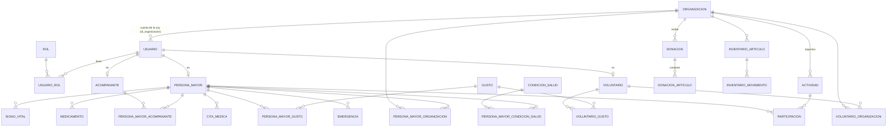

# Modelo de datos – VITA+

## Idea general

- **Una sola base PostgreSQL (Supabase) compartida por todos los microservicios.** No hay una base por servicio.
- **Cada tabla tiene un servicio "dueño"** que la crea y la modifica (JPA con `ddl-auto=update`).
- **Lectura entre servicios:** cuando un servicio necesita datos de otro, los lee con entidades `*Lookup`, que son de solo lectura, en vez de llamarlo por HTTP.
- **Llaves foráneas como enteros:** las relaciones entre tablas de servicios distintos se guardan como ids enteros (`id_persona_mayor`, `id_organizacion`…), no con `@ManyToOne`. Así cada servicio es independiente de las clases de los demás.
- **Patrón de herencia "tabla por subtipo":** `usuario` tiene los datos comunes y `persona_mayor`, `acompanante` y `voluntario` comparten su llave (`id_usuario`). Una cuenta puede tener varios roles (`usuario_rol`).
- **Vínculos con estado:** las relaciones entre personas son tablas intermedias con llave compuesta y un `estado` (`PENDIENTE`, `ACEPTADA`, `RECHAZADA`, `INACTIVA`, `CUENTA_INACTIVA`…) y `solicitada_por` (quién envió la solicitud).

## Diagrama

## Tablas por servicio dueño

### auth-service: cuentas, roles y sesión

| Tabla | Para qué | Campos clave |
|---|---|---|
| `usuario` | Datos comunes de toda cuenta | `id_usuario`, `nombre_usuario`, `correo`, `celular`, `contrasena_hash` (BCrypt), `fecha_nacimiento`, `genero`, `direccion`, `id_organizacion` (si es la cuenta de una organización), `activo`, `ultimo_rol`, `intentos_fallidos`, `bloqueado_hasta` |
| `rol` / `usuario_rol` | Roles (persona mayor, acompañante, voluntario, organización); una cuenta puede tener varios | PK compuesta (`id_usuario`, `id_rol`) |
| `persona_mayor` | Subtipo de usuario | `id_usuario` (PK = FK), `eps`, `ips`, `direccion_ips`, `vive_solo`, `uso_celular` |
| `acompanante`, `voluntario` | Subtipos de usuario | `id_usuario` (PK = FK) |
| `organizacion` | Organización | `id_organizacion`, `nombre`, `direccion` |
| `sesion` | Tokens de renovación (refresh); se guarda solo el hash | `id_usuario`, `hash_token`, `expira` |
| `aceptacion_terminos` | Constancia de aceptación de términos (Ley 1581) | `id_usuario`, `version_terminos`, `fecha_aceptacion` |
| `retiro_cuenta` | Por qué alguien eliminó su cuenta | `id_organizacion`, `rol`, `razon` |
| `calificacion_plataforma` | Estrellas y comentario sobre la plataforma | `id_usuario`, `estrellas` |

### persona-mayor-service: vínculos, gustos y emergencias

| Tabla | Para qué | Campos clave |
|---|---|---|
| `persona_mayor_acompanante` | Vínculo persona mayor ↔ acompañante | PK (`id_persona_mayor`, `id_acompanante`), `estado`, `solicitada_por`, `relacion` (hijo, sobrino…) |
| `persona_mayor_organizacion` | Vínculo persona mayor ↔ organización | PK (`id_persona_mayor`, `id_organizacion`), `estado`, `solicitada_por` |
| `gusto` | Catálogo de gustos, talentos, hobbies y profesiones | `nombre`, `categoria` (`GUSTO`, `TALENTO`, `HOBBY`, `PROFESION`) |
| `persona_mayor_gusto` | Gustos de cada persona mayor | PK (`id_persona_mayor`, `id_gusto`) |
| `emergencia` | Cada vez que se oprime el botón de emergencia | `id_persona_mayor`, `fecha_hora` |

Los **contactos de emergencia** no son una tabla aparte: son los acompañantes con vínculo aceptado.

### salud-service: datos de salud

| Tabla | Para qué | Campos clave |
|---|---|---|
| `signo_vital` | Historial de mediciones | `id_persona_mayor`, `fecha_hora`, presión sistólica/diastólica, frecuencia cardiaca y respiratoria, temperatura, saturación, peso, estatura |
| `medicamento` | Medicamentos y recordatorios | `nombre`, `dosis`, `frecuencia`, `intervalo_horas`, `proxima_toma`, `ultimo_recordatorio_enviado`, `activo` |
| `cita_medica` | Citas y acompañamiento | `fecha`, `hora`, `lugar`, `consultorio`, `acompanamiento`, `id_acompanante_cita`, `punto_encuentro`, marcas de recordatorio enviado |
| `condicion_salud` | Catálogo de enfermedades, alergias y discapacidades | `tipo`, `nombre`, `categoria` |
| `persona_mayor_condicion_salud` | Condiciones de cada persona | `id_persona_mayor`, `id_condicion_salud` (FK), `severidad`, `detalle` |
| `auditoria_salud` | Quién consultó o cambió datos de salud de quién (Ley 1581). La crean y llenan salud-service, acompanante-service y analitica-service | `id_usuario`, `rol`, `id_persona_mayor`, `recurso`, `accion`, `estado` HTTP, `fecha` |

### actividad-service

| Tabla | Para qué | Campos clave |
|---|---|---|
| `actividad` | Actividades de una organización (también las propuestas por voluntarios o personas mayores) | `id_organizacion`, `fecha`, `hora`, `lugar`, `latitud`/`longitud`, `tipo`, `cupos`, `frecuencia_dias` (periódicas), `estado`, `id_voluntario`, `id_persona_mayor_proponente` |
| `participacion` | Inscripción y asistencia | PK (`id_persona_mayor`, `id_actividad`), `asistio`, `recordatorio_enviado_para` |

### voluntario-service

| Tabla | Campos clave |
|---|---|
| `voluntario_organizacion` | PK (`id_voluntario`, `id_organizacion`), `estado` |
| `voluntario_gusto` | PK (`id_voluntario`, `id_gusto`), que usa el mismo catálogo `gusto` |

### organizacion-service

| Tabla | Campos clave |
|---|---|
| `nota_persona_mayor` | Notas internas de la organización sobre una persona: `id_organizacion`, `id_persona_mayor`, `texto`, `id_autor` |

Los vínculos `persona_mayor_organizacion` también se gestionan desde aquí.

### donacion-service

| Tabla | Para qué | Campos clave |
|---|---|---|
| `donacion` | Donación programada por un acompañante o voluntario | `id_donante`, `rol_donante`, `id_organizacion`, `fecha_entrega`, `estado` (`PROGRAMADA`, `RECIBIDA`, `NO_ENTREGADA`, `CANCELADA`…) |
| `donacion_articulo` | Artículos de cada donación (`@OneToMany`) | `categoria`, `cantidad`, `unidad`, `cantidad_recibida`, `fecha_vencimiento` |
| `inventario_articulo` | Inventario de la organización | `nombre`, `categoria`, `unidad`, `cantidad_minima` |
| `inventario_movimiento` | Entradas y salidas del inventario | `id_inventario`, `tipo`, `cantidad`, `motivo`, `id_donacion` |

### mensajeria-service

| Tabla | Para qué | Campos clave |
|---|---|---|
| `notificacion` | SMS enviados (campanita del panel) | `celular`, `mensaje`, `fecha_envio`, `leida` |
| `preferencia_notificacion` | Tipos de aviso que el usuario apagó | `id_usuario`, `tipo`, `activa` |

### analitica-service

No tiene tablas propias, salvo que escribe en `auditoria_salud`. Lee todo con SQL (`NamedParameterJdbcTemplate`) para los reportes, el K-means de perfiles, las recomendaciones y la red de apoyo.

## Respuestas rápidas para la sustentación

- **¿Por qué una sola base si son microservicios?** Por simplicidad y costo en un proyecto académico (un solo Supabase). Se compensa con que cada tabla tiene un único servicio dueño que escribe en ella; los demás solo la leen.
- **¿Cómo se relaciona una persona mayor con su organización y acompañantes?** Con tablas intermedias de llave compuesta y un campo `estado`. La relación pasa por solicitud y aceptación.
- **¿Dónde están los roles?** `usuario` más un subtipo por rol y `usuario_rol`. Una persona puede ser, por ejemplo, acompañante y voluntario a la vez.
- **¿Cómo se protegen los datos sensibles?** Contraseñas y tokens de renovación guardados como hash, auditoría de cada acceso a datos de salud (`auditoria_salud`) y constancia de aceptación de términos.
